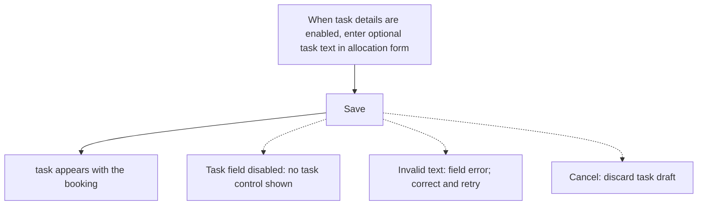
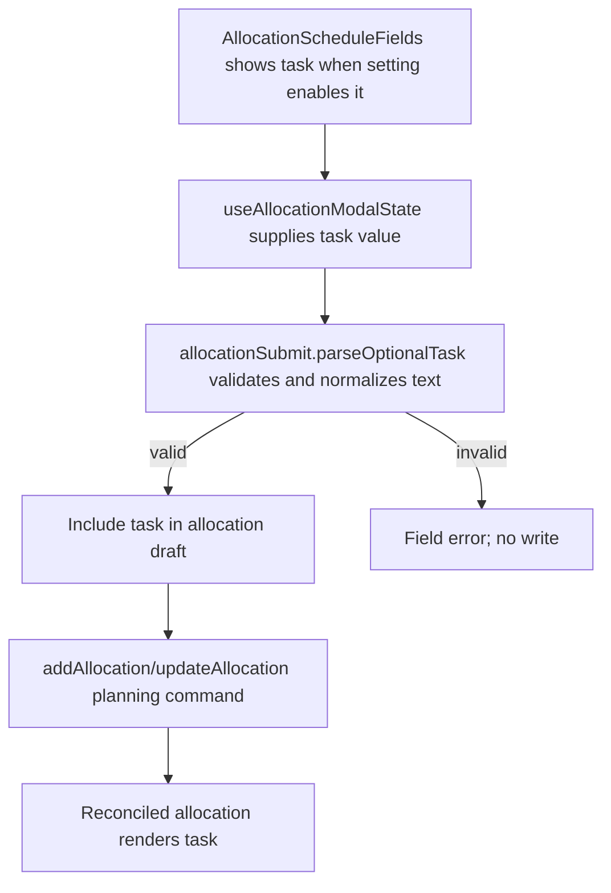

# US-ALL-10 — Add an optional task to an allocation

As an Editor, I want to add a short task description so that an allocation can carry context without replacing its activity.

**Status:** Current
**Access:** Editor, Admin or Owner
**Entry:** Schedule (`/`)
**Documentation:** [schedule-work.md](../../docs-src/using/schedule-work.md)
**Source:** [AllocationScheduleFields.tsx](../../apps/frontend/src/components/scheduler/AllocationScheduleFields.tsx), [AllocationTargetFields.tsx](../../apps/frontend/src/components/scheduler/AllocationTargetFields.tsx)

## Acceptance criteria

| Field | Control    | Required/default/conditions                                                                                                                        |
| ----- | ---------- | -------------------------------------------------------------------------------------------------------------------------------------------------- |
| Task  | Text input | Optional; up to 100 characters; shown only when the company enables Show task field in schedule. Hidden task text is kept when the setting is off. |

## User flow

## Code flow

**Code references:**

- [AllocationScheduleFields.tsx](../../apps/frontend/src/components/scheduler/AllocationScheduleFields.tsx)
- [useAllocationModalState.ts](../../apps/frontend/src/components/scheduler/useAllocationModalState.ts)
- [allocationSubmit.ts](../../apps/frontend/src/components/scheduler/allocationSubmit.ts)
