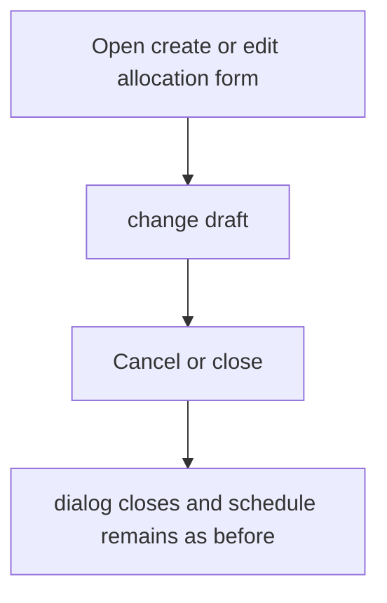
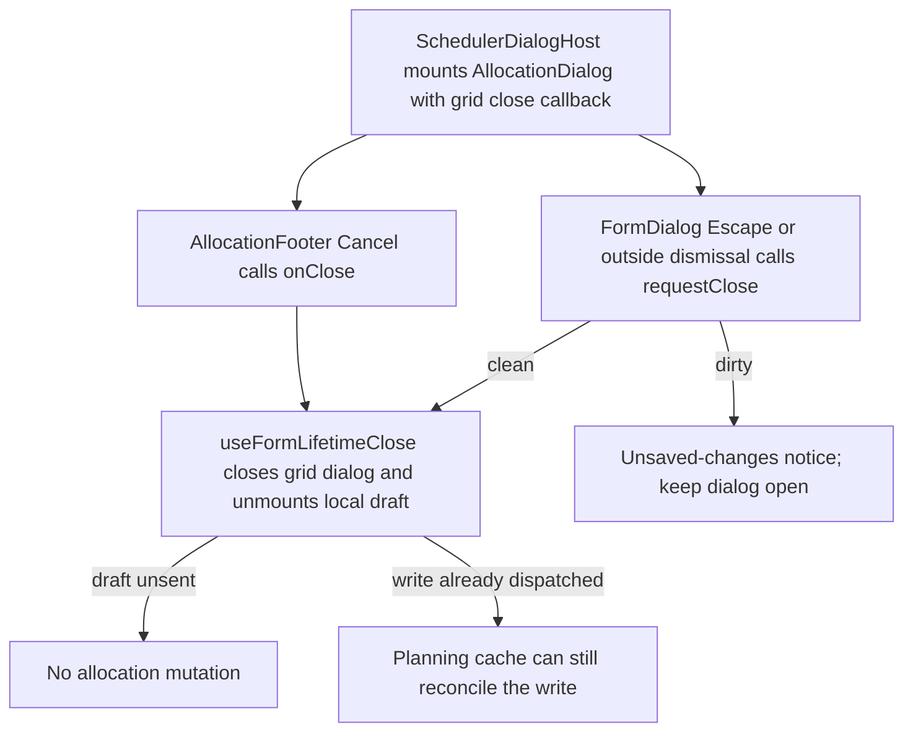

# US-ALL-11 — Cancel allocation create or edit

As an Editor, I want to cancel an allocation form so that an unsaved draft is discarded.

**Status:** Current
**Access:** Editor, Admin or Owner
**Entry:** New allocation or Edit allocation dialog
**Documentation:** [schedule-work.md](../../docs-src/using/schedule-work.md)
**Source:** [AllocationDialog.tsx](../../apps/frontend/src/components/scheduler/AllocationDialog.tsx)

## Acceptance criteria

- **Cancel** or the close control closes the dialog without creating or changing an allocation.

## User flow

## Code flow

The separately saved inline activity survives allocation form dismissal.

**Code references:**

- [SchedulerGrid.tsx](../../apps/frontend/src/components/scheduler/SchedulerGrid.tsx#L196)
- [AllocationDialog.tsx](../../apps/frontend/src/components/scheduler/AllocationDialog.tsx#L24)
- [AllocationFooter.tsx](../../apps/frontend/src/components/scheduler/AllocationFooter.tsx#L59)
- [dialogs.tsx](../../apps/frontend/src/components/common/dialogs.tsx#L72)
- [dialogs.tsx](../../apps/frontend/src/components/common/dialogs.tsx#L154)
- [useFormLifetimeClose.ts](../../apps/frontend/src/hooks/useFormLifetimeClose.ts#L4)
- [allocationSubmit.ts](../../apps/frontend/src/components/scheduler/allocationSubmit.ts#L246)
