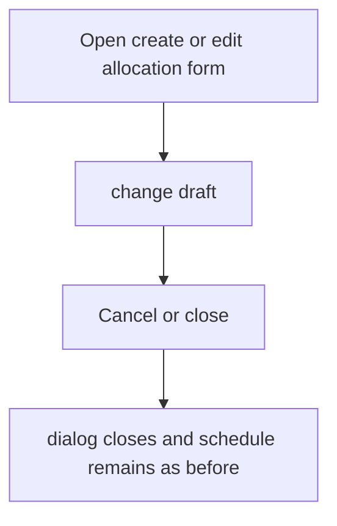
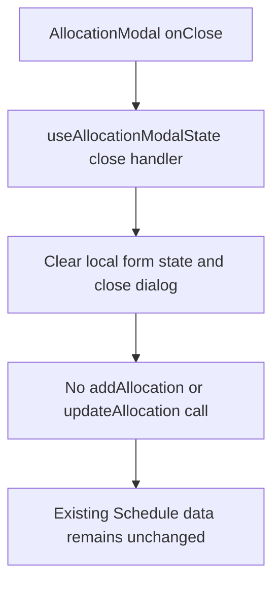

# US-ALL-11 — Cancel allocation create or edit

As an Editor, I want to cancel an allocation form so that an unsaved draft is discarded.

**Status:** Current
**Access:** Editor, Admin or Owner
**Entry:** New allocation or Edit allocation dialog
**Documentation:** [schedule-work.md](../../docs-src/using/schedule-work.md)
**Source:** [AllocationModal.tsx](../../apps/frontend/src/components/scheduler/AllocationModal.tsx)

## Acceptance criteria

- **Cancel** or the close control closes the dialog without creating or changing an allocation.

## User flow

## Code flow

**Code references:**

- [AllocationModal.tsx](../../apps/frontend/src/components/scheduler/AllocationModal.tsx)
- [useAllocationModalState.ts](../../apps/frontend/src/components/scheduler/useAllocationModalState.ts)
