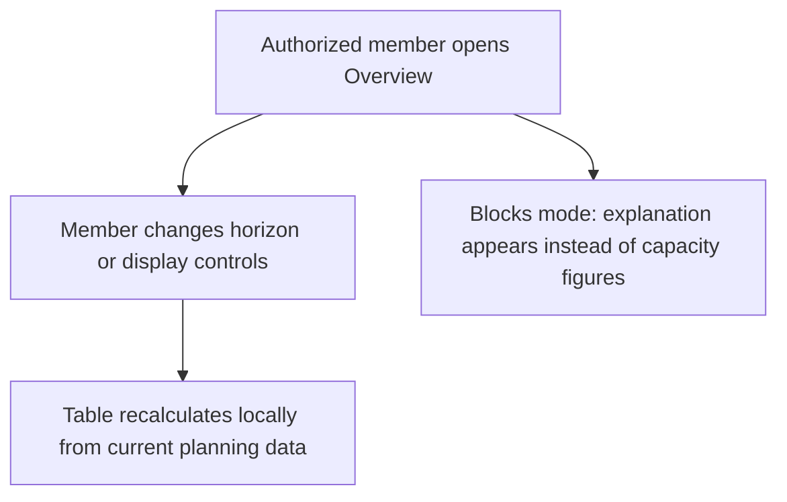
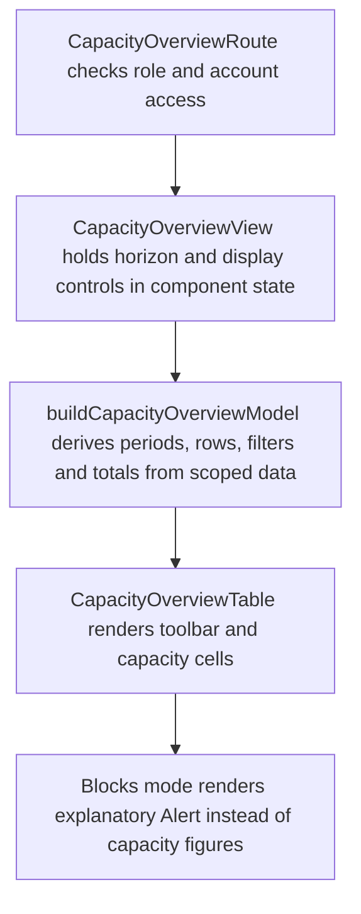

# US-CAP-01 — Review four-, eight- or twelve-week capacity

As a company member, I want to compare available capacity across the selected weeks so that I can decide where upcoming work can fit.

**Status:** Current

**Access:** Owners and Admins configure access; default is Owner/Admin, with Editor or Everyone options

**Entry:** Overview page

**Documentation:** [overview.md](../../docs-src/using/overview.md)

**Source:** [CapacityOverviewView.tsx](../../apps/frontend/src/components/capacity-overview/CapacityOverviewView.tsx)

## Acceptance criteria

- **Weeks visible** offers 4, 8 or 12 weeks, defaults to 4, and returns to 4 on reopening; the first column covers the remainder of the current week.
- **Ledger** and **Load curve** switch the cell display; each shows the same capacity and remains accessible to assistive technology.
- **Tentative**, **Has availability** and **Totals** change the displayed demand, people or weekly summary; they default to on, off and off respectively.
- Discipline groups can be collapsed; placeholders appear as unassigned demand only when placeholders are enabled.
- Owners and Admins configure page access as Admins, Admins & Editors or Everyone; the default is Admins.

## User flow

## Code flow

**Code references:** [router.tsx](../../apps/frontend/src/router.tsx), [capacityOverviewAccess.ts](../../apps/frontend/src/auth/capacityOverviewAccess.ts), [selectors.ts](../../apps/frontend/src/store/selectors.ts), [CapacityOverviewView.tsx](../../apps/frontend/src/components/capacity-overview/CapacityOverviewView.tsx), [capacityOverviewModel.ts](../../apps/frontend/src/components/capacity-overview/capacityOverviewModel.ts), [CapacityOverviewTable.tsx](../../apps/frontend/src/components/capacity-overview/CapacityOverviewTable.tsx), [OverviewToolbar.tsx](../../apps/frontend/src/components/capacity-overview/OverviewToolbar.tsx), [CapacityOverviewCells.tsx](../../apps/frontend/src/components/capacity-overview/CapacityOverviewCells.tsx)
