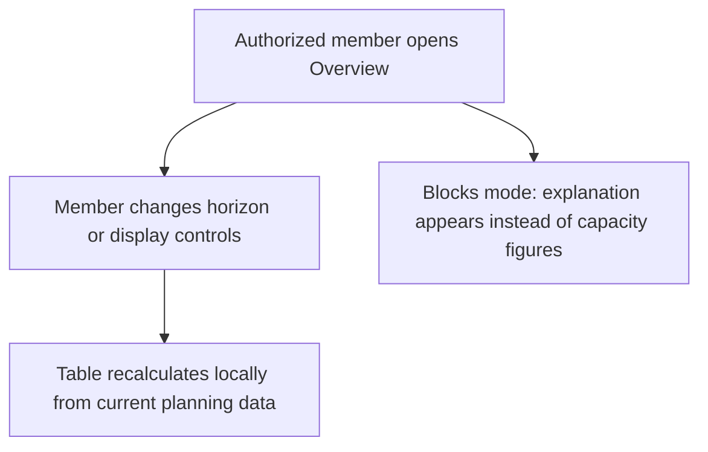
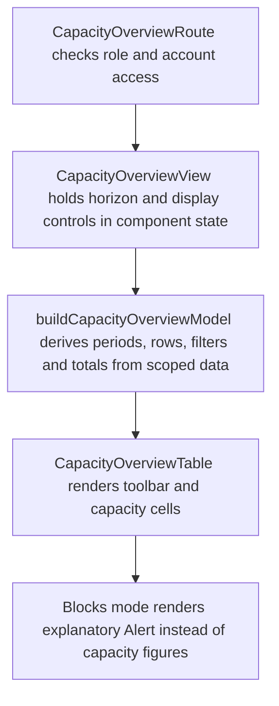

# US-CAP-01 — Review four-, eight- or twelve-week capacity

As a company member, I want to compare available capacity across the selected weeks so that I can decide where upcoming work can fit.

**Status:** Current

**Access:** Owner and Admin by default; Overview access can add Editors or Everyone

**Entry:** Overview page

**Documentation:** [overview.md](../../docs-src/using/overview.md)

**Source:** [CapacityOverviewView.tsx](../../apps/frontend/src/components/capacity-overview/CapacityOverviewView.tsx)

## Acceptance criteria

- The **Overview horizon** control offers 4 weeks, 8 weeks or 12 weeks, defaults to 4 weeks and returns to 4 weeks when the page is reopened; the first column runs from today to the end of the current week.
- **Ledger** and **Load curve** switch the cell display; each shows the same capacity and remains accessible to assistive technology.
- **Tentative**, **Has availability** and **Totals** change the displayed demand, people or weekly summary; they default to on, off and off respectively.
- With disciplines enabled, people are grouped by discipline, and people without one appear under **Unassigned**; with disciplines off, people appear under **Overall**. Either fallback splits into **Studio** and **Supplementary** when an active Supplementary person exists. Every group can be collapsed.
- Active placeholders appear under **Unassigned demand** only when placeholders are enabled. External, archived and deleted resources are excluded.
- With Blocks scheduling input, the page shows **Overview needs measured capacity** instead of the table.
- Owners and Admins set Settings → **Overview access** to Admins, Admins & Editors or Everyone; the default is Admins. Owners and Admins always have access.

## User flow

## Code flow

**Code references:** [router.tsx](../../apps/frontend/src/router.tsx), [capacityOverviewAccess.ts](../../apps/frontend/src/auth/capacityOverviewAccess.ts), [selectors.ts](../../apps/frontend/src/store/selectors.ts), [CapacityOverviewView.tsx](../../apps/frontend/src/components/capacity-overview/CapacityOverviewView.tsx), [capacityOverviewModel.ts](../../apps/frontend/src/components/capacity-overview/capacityOverviewModel.ts), [CapacityOverviewTable.tsx](../../apps/frontend/src/components/capacity-overview/CapacityOverviewTable.tsx), [OverviewToolbar.tsx](../../apps/frontend/src/components/capacity-overview/OverviewToolbar.tsx), [CapacityOverviewCells.tsx](../../apps/frontend/src/components/capacity-overview/CapacityOverviewCells.tsx)
