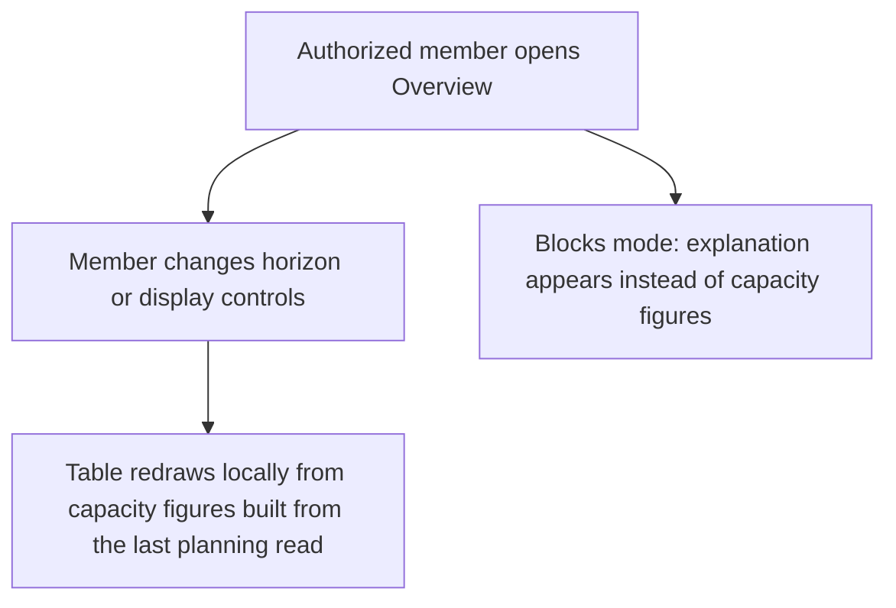
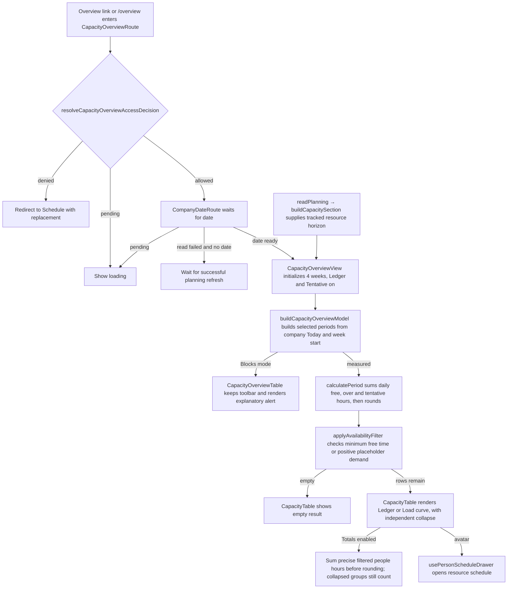

# US-CAP-01 — Review four-, eight- or twelve-week capacity

As a company member, I want to compare available capacity across the selected weeks so that I can decide where upcoming work can fit.

**Status:** Current

**Access:** Owner and Admin by default; Overview access can add Editors or Everyone

**Entry:** Overview page

**Documentation:** [overview.md](../../docs-src/using/overview.md)

**Source:** [CapacityOverviewView.tsx](../../apps/frontend/src/components/capacity-overview/CapacityOverviewView.tsx)

## Acceptance criteria

- The **Overview horizon** control offers 4 weeks, 8 weeks or 12 weeks, defaults to 4 weeks and returns to 4 weeks when the page is reopened; the first column runs from today to the end of the current week.
- **Ledger** and **Load curve** switch the cell display; each shows the same capacity and remains accessible to assistive technology.
- **Tentative**, **Has availability** and **Totals** change the displayed demand, people or weekly summary; they default to on, off and off respectively.
- With disciplines enabled, people are grouped by discipline, and people without one appear under **Unassigned**; with disciplines off, people appear under **Overall**. Either fallback splits into **Studio** and **Supplementary** when an active Supplementary person exists. Every group can be collapsed.
- Active placeholders appear under **Unassigned demand** only when placeholders are enabled. External, archived and deleted resources are excluded.
- With Blocks scheduling input, the page shows **Overview needs measured capacity** instead of the table.
- Owners and Admins set Settings → **Overview access** to Admins, Admins & Editors or Everyone; the default is Admins. Owners and Admins always have access.

## User flow

## Code flow

The horizon covers the remainder of the company week and subsequent full weeks. Has availability and Totals start off. Horizon changes aggregate existing figures locally. Tentative toggles between all load and confirmed/completed load. Free capacity rounds down and overload rounds up to quarter days using eight hours per day. Overview access is a page-visibility setting. The avatar path continues in [US-SCH-20](../scheduler/US-SCH-20-person-schedule-drawer.md).

**Code references:**

- [router.tsx](../../apps/frontend/src/router.tsx#L120)
- [planning_service.ts](../../apps/backend/app/services/planning_service.ts#L130)
- [capacity.ts](../../packages/shared/src/lib/capacity.ts#L183)
- [CapacityOverviewView.tsx](../../apps/frontend/src/components/capacity-overview/CapacityOverviewView.tsx#L17)
- [capacityOverviewModel.ts](../../apps/frontend/src/components/capacity-overview/capacityOverviewModel.ts#L69)
- [capacityOverviewModel.ts](../../apps/frontend/src/components/capacity-overview/capacityOverviewModel.ts#L207)
- [CapacityOverviewTable.tsx](../../apps/frontend/src/components/capacity-overview/CapacityOverviewTable.tsx#L50)
- [CapacityOverviewTableGrid.tsx](../../apps/frontend/src/components/capacity-overview/CapacityOverviewTableGrid.tsx#L247)
- [capacityOverviewBar.ts](../../apps/frontend/src/components/capacity-overview/capacityOverviewBar.ts#L98)
- [CapacityOverviewCells.tsx](../../apps/frontend/src/components/capacity-overview/CapacityOverviewCells.tsx#L135)
- [capacityOverview.test.ts](../../apps/frontend/src/components/capacity-overview/capacityOverview.test.ts#L254)
