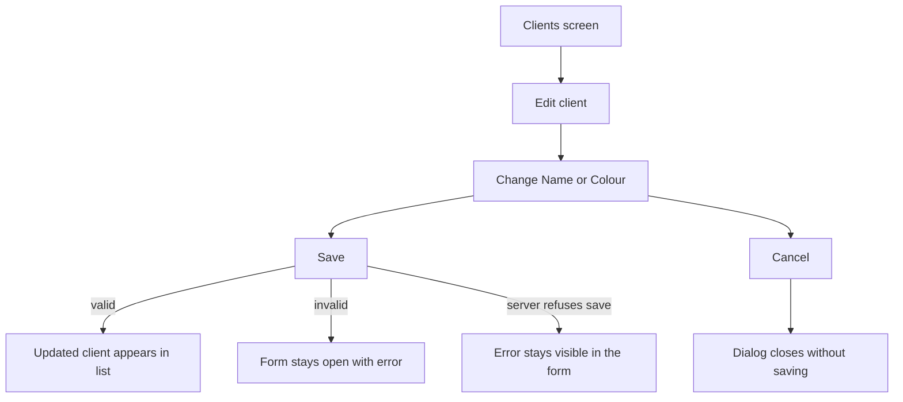
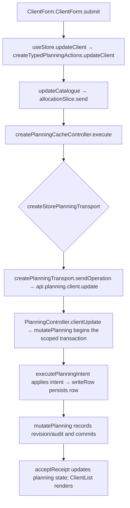

# US-CLI-02 — Edit a client

As an Editor, I want to edit a client name and colour so that the updated details appear wherever the client is shown.

**Status:** Current
**Access:** Editor and above (Editor, Admin, Owner)
**Entry:** Clients screen → client row → Edit
**Documentation:** [Clients and projects guide](../../docs-src/using/projects.md)
**Source:** [ClientList.tsx](../../apps/frontend/src/components/clients/ClientList.tsx) · [ClientForm.tsx](../../apps/frontend/src/components/clients/ClientForm.tsx)

## Acceptance criteria

| Field         | Control         | Required/default/conditions                                                                  |
| ------------- | --------------- | -------------------------------------------------------------------------------------------- |
| Name          | Text field      | Required; current value prefilled; read-only for non-Owners when the client uses a code name |
| Use code name | Switch          | Owner only; current value prefilled                                                          |
| Code name     | Text field      | Owner only; shown and required when Use code name is on                                      |
| Colour        | Preset swatches | Current colour preselected                                                                   |

- **Save** updates the client; invalid required values keep the form open with an error. **Cancel** closes without saving.

## User flow

## Code flow

**Code references:** [ClientForm.tsx](../../apps/frontend/src/components/clients/ClientForm.tsx) · [typedPlanningActions.ts](../../apps/frontend/src/store/typedPlanningActions.ts) · [allocationSlice.ts](../../apps/frontend/src/store/slices/allocationSlice.ts) · [planningCacheController.ts](../../apps/frontend/src/data/planning/planningCacheController.ts) · [storePlanningTransport.ts](../../apps/frontend/src/data/planning/storePlanningTransport.ts) · [planningTransport.ts](../../apps/frontend/src/data/planning/planningTransport.ts) · [planning_routes.ts](../../apps/backend/start/planning_routes.ts) · [planning_controller.ts](../../apps/backend/app/controllers/planning_controller.ts) · [planning.ts](../../apps/backend/app/services/planning.ts) · [execute.ts](../../apps/backend/app/services/planning/execute.ts) · [writer.ts](../../apps/backend/app/services/planning/writer.ts)
