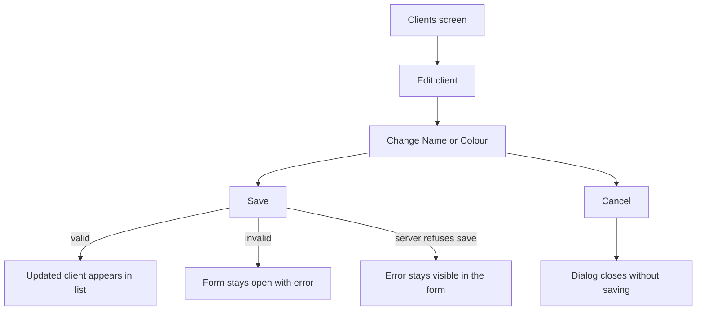
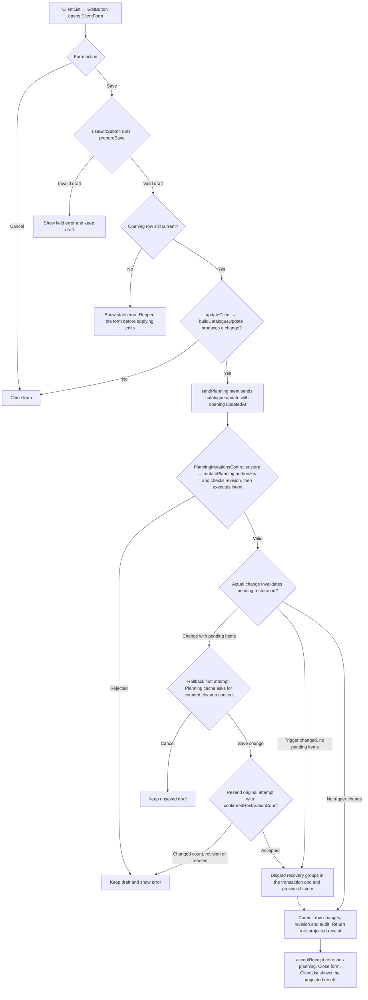

# US-CLI-02 — Edit a client

As an Editor, I want to edit a client name and colour so that the updated details appear wherever the client is shown.

**Status:** Current
**Access:** Editor and above (Editor, Admin, Owner)
**Entry:** Clients screen → client row → Edit
**Documentation:** [Clients and projects guide](../../docs-src/using/projects.md)
**Source:** [ClientList.tsx](../../apps/frontend/src/components/clients/ClientList.tsx) · [ClientForm.tsx](../../apps/frontend/src/components/clients/ClientForm.tsx)

## Acceptance criteria

| Field         | Control         | Required/default/conditions                                                                  |
| ------------- | --------------- | -------------------------------------------------------------------------------------------- |
| Name          | Text field      | Required; current value prefilled; read-only for non-Owners when the client uses a code name |
| Use code name | Switch          | Owner only; current value prefilled                                                          |
| Code name     | Text field      | Owner only; shown and required when Use code name is on                                      |
| Colour        | Preset swatches | Current colour preselected                                                                   |

- **Save** updates the client; invalid required values keep the form open with an error. **Cancel** closes without saving.

## User flow

## Code flow

Owner, Admin and Editor can write planning data. Viewer and view-as-member lack write authority. The write goes through `POST /api/companies/:companyId/planning/mutations` with admitted company access. The planning cache refreshes on a stale revision and reconciles an uncertain write before another attempt. Footer Cancel closes the form, including during a pending save. The dispatched save can still settle. The list excludes Internal. `usePrivateNameFields` locks a non-Owner’s private name field and omits privacy fields. The server refuses unauthorized privacy fields and pins the existing real name for a restricted writer. A privacy edit by an Owner shares the cleanup path in US-CLI-05.

**Code references:** [ClientList.tsx](../../apps/frontend/src/components/clients/ClientList.tsx#L63) · [ClientForm.tsx](../../apps/frontend/src/components/clients/ClientForm.tsx#L95) · [entity_rules.ts](../../apps/backend/app/services/planning/entity_rules.ts#L88) · [restoration_pending_groups.spec.ts](../../apps/backend/tests/functional/planning/restoration_pending_groups.spec.ts#L28) · [Write controls](../../apps/frontend/src/components/common/crudButtons.tsx#L7) · [Cancel button](../../apps/frontend/src/components/common/FormButtons.tsx#L17) · [useEditSubmit.ts](../../apps/frontend/src/hooks/useEditSubmit.ts#L44) · [Row checks](../../apps/backend/app/services/planning/entity_write.ts#L97) · [typedPlanningActions.ts](../../apps/frontend/src/store/typedPlanningActions.ts#L185) · [planningIntents.ts](../../apps/frontend/src/data/planning/planningIntents.ts#L502) · [sendPlanningIntent](../../apps/frontend/src/store/slices/planningSessionSlice.ts#L139) · [Planning transport](../../apps/frontend/src/data/planning/planningTransport.ts#L64) · [Planning route](../../apps/backend/start/planning_routes.ts#L16) · [Mutation controller](../../apps/backend/app/controllers/planning_mutations_controller.ts#L17) · [Planning transaction](../../apps/backend/app/services/planning.ts#L198) · [Company write authority](../../apps/backend/app/services/planning/access.ts#L17) · [Receipt and refresh](../../apps/frontend/src/data/planning/planningCache.ts#L469) · [usePrivateNameFields.ts](../../apps/frontend/src/components/common/usePrivateNameFields.ts#L27) · [restricted_fields.ts](../../apps/backend/app/services/planning/restricted_fields.ts#L21) · [mutation_changes.ts](../../apps/backend/app/services/planning/mutation_changes.ts#L74) · [Confirmation retry](../../apps/frontend/src/data/planning/planningCache.ts#L420) · [Role projection](../../apps/backend/app/transformers/state_transformer.ts#L46)
