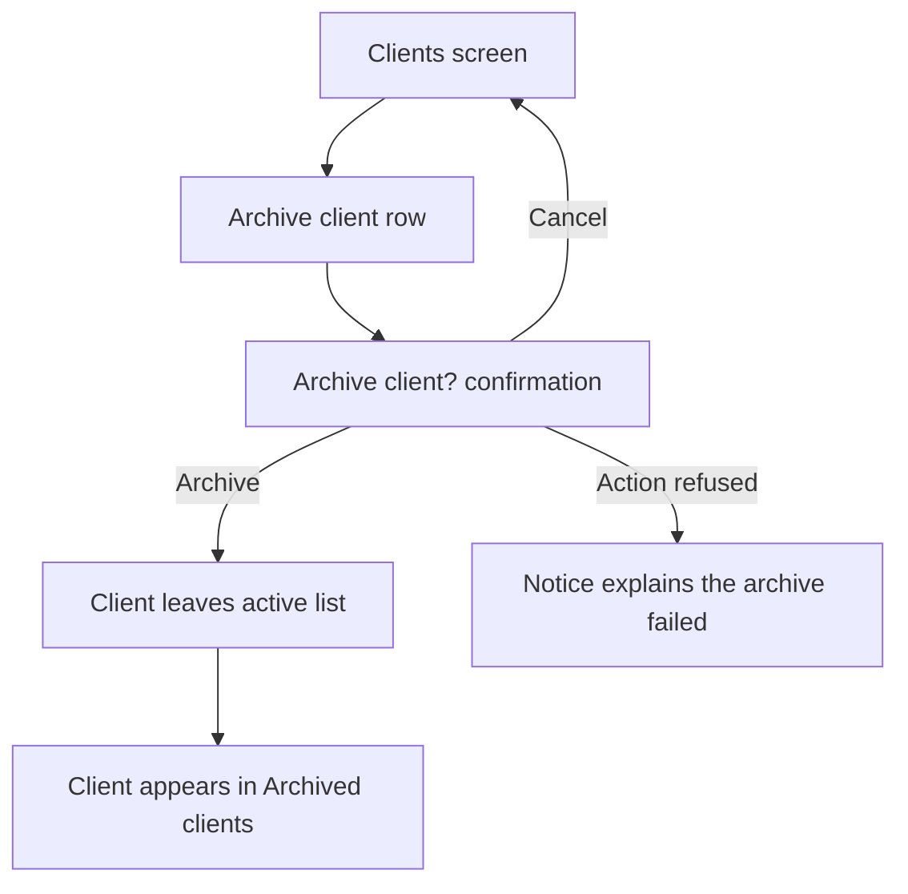
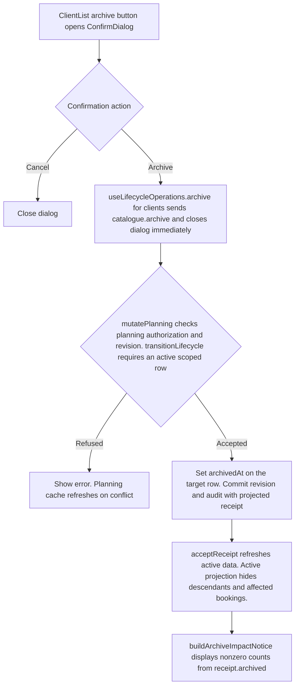

# US-CLI-03 — Archive a client

As an Editor, I want to archive a client so that its work leaves active views while remaining restorable.

**Status:** Current
**Access:** Editor and above (Editor, Admin, Owner)
**Entry:** Clients screen → client row → Archive {client name}
**Documentation:** [Clients and projects guide](../../docs-src/using/projects.md)
**Source:** [ClientList.tsx](../../apps/frontend/src/components/clients/ClientList.tsx) · [ArchivedEntitySection.tsx](../../apps/frontend/src/components/common/ArchivedEntitySection.tsx)

## Acceptance criteria

- Selecting **Archive {name}** opens **Archive client?** with **Archive** and **Cancel** controls.
- The dialog explains that descendants are hidden and restorable, and states no count. After **Archive**, a notice reports the hidden projects, phases and allocations when there are any.
- **Cancel** closes the dialog without archiving. **Archive** archives the record.
- The archived record appears in its archived section with a **Restore** control.

## User flow

## Code flow

Owner, Admin and Editor can write planning data. Viewer and view-as-member lack write authority. Archive data is read through the Editor recovery section or the Owner/Admin inactive section. The active projection determines descendant visibility from retained links. `useLifecycleOperations` skips dispatch after a company change. `endsHistory` omits the history id and `notifyInactiveDataChanged` refreshes the inactive list. The list offers Restore for reversal. The server also refuses archiving Internal. The transaction archives only the client row. Receipt counts cover newly hidden projects, phases and allocations, with no notice when all of those counts are zero.

**Code references:** [ClientList.tsx](../../apps/frontend/src/components/clients/ClientList.tsx#L63) · [dialogs.tsx](../../apps/frontend/src/components/common/dialogs.tsx#L202) · [useLifecycleOperations.ts](../../apps/frontend/src/hooks/useLifecycleOperations.ts#L51) · [planning_execution_service.ts](../../apps/backend/app/services/planning/planning_execution_service.ts#L483) · [projection.ts](../../packages/shared/src/domain/lifecycle/projection.ts#L36) · [sendPlanningIntent](../../apps/frontend/src/store/slices/planningSessionSlice.ts#L139) · [Planning transport](../../apps/frontend/src/data/planning/planningTransport.ts#L64) · [Planning route](../../apps/backend/start/planning_routes.ts#L16) · [Mutation controller](../../apps/backend/app/controllers/planning_mutations_controller.ts#L19) · [Planning transaction](../../apps/backend/app/services/planning_service.ts#L222) · [Company write authority](../../apps/backend/app/services/planning/planning_access_service.ts#L31) · [Receipt and refresh](../../apps/frontend/src/data/planning/planningCache.ts#L469) · [Archive access split](../../apps/frontend/src/components/common/ArchivedEntitySection.tsx#L250) · [Editor recovery controls](../../apps/frontend/src/components/common/ArchiveRecoverySection.tsx#L27) · [Editor recovery read](../../apps/backend/app/services/planning_service.ts#L169) · [useInactiveCompanyData.ts](../../apps/frontend/src/hooks/useInactiveCompanyData.ts#L17) · [Inactive state authority](../../apps/backend/app/controllers/company_state_controller.ts#L32) · [Ancestor lookup](../../apps/frontend/src/components/common/archivedEntityRows.ts#L73) · [Editor recovery projection](../../packages/shared/src/domain/lifecycle/archiveRecovery.ts#L25) · [impact.ts](../../packages/shared/src/domain/lifecycle/impact.ts#L45) · [ClientList.tsx](../../apps/frontend/src/components/clients/ClientList.tsx#L108) · [archiveImpactCopy.ts](../../apps/frontend/src/lib/archiveImpactCopy.ts#L14)
