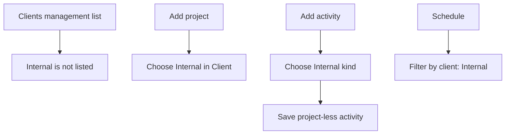
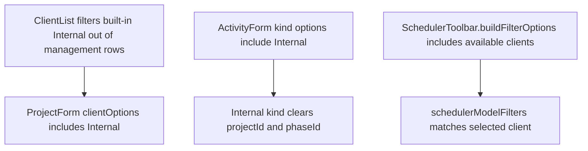

# US-CLI-04 — The built-in "Internal" client

As an Editor, I want Internal work to have a built-in client grouping so that project-less work can be filtered alongside Internal projects.

**Status:** Current
**Access:** Editors and above manage projects and activities; all roles can view and filter Internal work
**Entry:** Projects screen → Client picker; Activities screen → Internal kind; Schedule → Filter by client
**Documentation:** [Clients and projects guide](../../docs-src/using/projects.md)
**Source:** [ClientList.tsx](../../apps/frontend/src/components/clients/ClientList.tsx) · [ProjectForm.tsx](../../apps/frontend/src/components/projects/ProjectForm.tsx) · [ActivityForm.tsx](../../apps/frontend/src/components/activities/ActivityForm.tsx)

## Acceptance criteria

- The built-in **Internal** client is absent from Clients management.
- **Client** in Add/Edit project includes Internal; the Schedule **Filter by client** includes Internal.
- Choosing the **Internal** activity kind hides the Project picker and saves a project-less activity.

## User flow

## Code flow

**Code references:** [ClientList.tsx](../../apps/frontend/src/components/clients/ClientList.tsx) · [ProjectForm.tsx](../../apps/frontend/src/components/projects/ProjectForm.tsx) · [ActivityForm.tsx](../../apps/frontend/src/components/activities/ActivityForm.tsx) · [SchedulerToolbar.tsx](../../apps/frontend/src/components/scheduler/SchedulerToolbar.tsx) · [toolbarFilterOptions.ts](../../apps/frontend/src/components/scheduler/toolbarFilterOptions.ts) · [schedulerModelFilters.ts](../../apps/frontend/src/components/scheduler/schedulerModelFilters.ts) · [selectors.ts](../../apps/frontend/src/store/selectors.ts)
