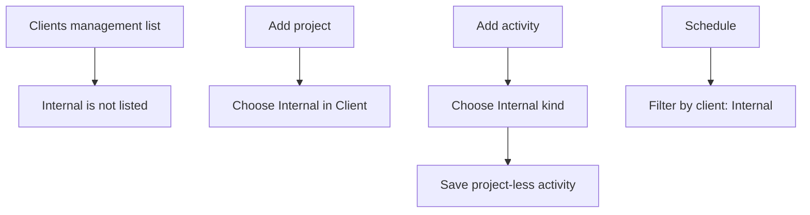
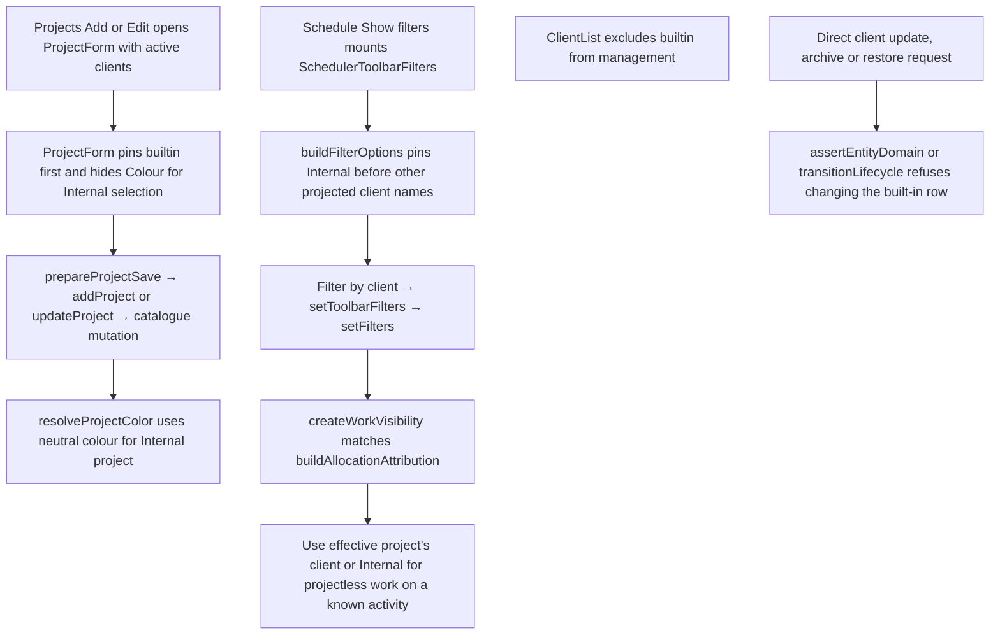

# US-CLI-04 — The built-in "Internal" client

As an Editor, I want Internal work to have a built-in client grouping so that project-less work can be filtered alongside Internal projects.

**Status:** Current
**Access:** Editors and above manage projects and activities; all roles can view and filter Internal work
**Entry:** Projects screen → Client picker; Activities screen → Internal kind; Schedule → Filter by client
**Documentation:** [Clients and projects guide](../../docs-src/using/projects.md)
**Source:** [ClientList.tsx](../../apps/frontend/src/components/clients/ClientList.tsx) · [ProjectForm.tsx](../../apps/frontend/src/components/projects/ProjectForm.tsx) · [ActivityForm.tsx](../../apps/frontend/src/components/activities/ActivityForm.tsx)

## Acceptance criteria

- The built-in **Internal** client is absent from Clients management.
- **Client** in Add/Edit project includes Internal; the Schedule **Filter by client** includes Internal.
- Choosing the **Internal** activity kind hides the Project picker and saves a project-less activity.

## User flow

## Code flow

Owner, Admin and Editor can choose the client on project writes. Every Schedule reader can filter the role-projected data locally. The project save uses `useEditSubmit` with its normal cancel, validation and conflict paths. Choosing All clients clears the schedule’s client and project filters. Internal activity kind is a separate activity-form choice.

**Code references:** [ProjectList.tsx](../../apps/frontend/src/components/projects/ProjectList.tsx#L69) · [ProjectForm.tsx](../../apps/frontend/src/components/projects/ProjectForm.tsx#L151) · [ClientList.tsx](../../apps/frontend/src/components/clients/ClientList.tsx#L63) · [ClientForm.tsx](../../apps/frontend/src/components/clients/ClientForm.tsx#L95) · [color.ts](../../packages/shared/src/lib/color.ts#L90) · [toolbarFilterOptions.ts](../../apps/frontend/src/components/scheduler/toolbarFilterOptions.ts#L21) · [useToolbarSearch.ts](../../apps/frontend/src/components/scheduler/useToolbarSearch.ts#L47) · [buildAllocationAttribution.ts](../../apps/frontend/src/lib/buildAllocationAttribution.ts#L18) · [schedulerModelFilters.ts](../../apps/frontend/src/components/scheduler/schedulerModelFilters.ts#L31) · [domain.ts](../../apps/backend/app/services/planning/entity_validation/domain.ts#L43) · [execute.ts](../../apps/backend/app/services/planning/execute.ts#L65) · [useEditSubmit.ts](../../apps/frontend/src/hooks/useEditSubmit.ts#L44) · [sendPlanningIntent](../../apps/frontend/src/store/slices/planningSessionSlice.ts#L139) · [Planning transport](../../apps/frontend/src/data/planning/planningTransport.ts#L64) · [Planning route](../../apps/backend/start/planning_routes.ts#L16) · [Mutation controller](../../apps/backend/app/controllers/planning_mutations_controller.ts#L9) · [Planning transaction](../../apps/backend/app/services/planning.ts#L198) · [Company write authority](../../apps/backend/app/services/planning/access.ts#L16) · [Receipt and refresh](../../apps/frontend/src/data/planning/planningCache.ts#L469)
