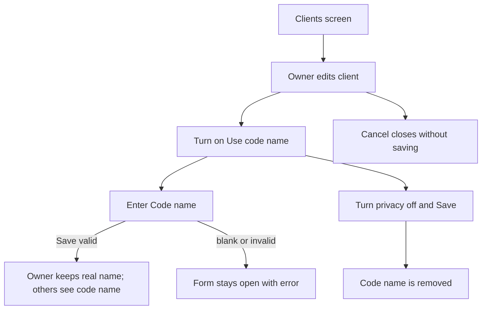
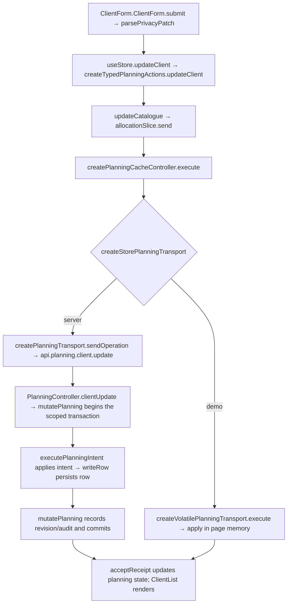

# US-CLI-05 — Mark a client private with a code name

As an Owner, I want to set a client code name so that non-Owners see the safe name while Owners retain the real name.

**Status:** Current
**Access:** Editor and above for ordinary fields; Owner only for privacy and code-name fields
**Entry:** Clients screen → client row → Edit (Owner only for private fields)
**Documentation:** [Clients and projects guide](../../docs-src/using/projects.md)
**Source:** [ClientList.tsx](../../apps/frontend/src/components/clients/ClientList.tsx) · [ClientForm.tsx](../../apps/frontend/src/components/clients/ClientForm.tsx)

## Acceptance criteria

| Field         | Control         | Required/default/conditions                   |
| ------------- | --------------- | --------------------------------------------- |
| Name          | Text field      | Required                                      |
| Use code name | Switch          | Owner only; off by default for public records |
| Code name     | Text field      | Owner only; required when Use code name is on |
| Colour        | Preset swatches | Current colour preselected                    |

- **Save** updates the real name or code name and preset colour. Non-Owners continue to see the code name. Missing code name keeps the form open with an error. **Cancel** closes without saving.

## User flow

## Code flow

**Code references:** [ClientForm.tsx](../../apps/frontend/src/components/clients/ClientForm.tsx) · [typedPlanningActions.ts](../../apps/frontend/src/store/typedPlanningActions.ts) · [allocationSlice.ts](../../apps/frontend/src/store/slices/allocationSlice.ts) · [planningCacheController.ts](../../apps/frontend/src/data/planning/planningCacheController.ts) · [storePlanningTransport.ts](../../apps/frontend/src/data/planning/storePlanningTransport.ts) · [planningTransport.ts](../../apps/frontend/src/data/planning/planningTransport.ts) · [volatilePlanningTransport.ts](../../apps/frontend/src/data/planning/volatilePlanningTransport.ts) · [planning_routes.ts](../../apps/backend/start/planning_routes.ts) · [planning_controller.ts](../../apps/backend/app/controllers/planning_controller.ts) · [planning.ts](../../apps/backend/app/services/planning.ts) · [execute.ts](../../apps/backend/app/services/planning/execute.ts) · [usePrivateNameFields.ts](../../apps/frontend/src/components/common/usePrivateNameFields.ts) · [PrivateNameFields.tsx](../../apps/frontend/src/components/common/PrivateNameFields.tsx) · [writer.ts](../../apps/backend/app/services/planning/writer.ts)
