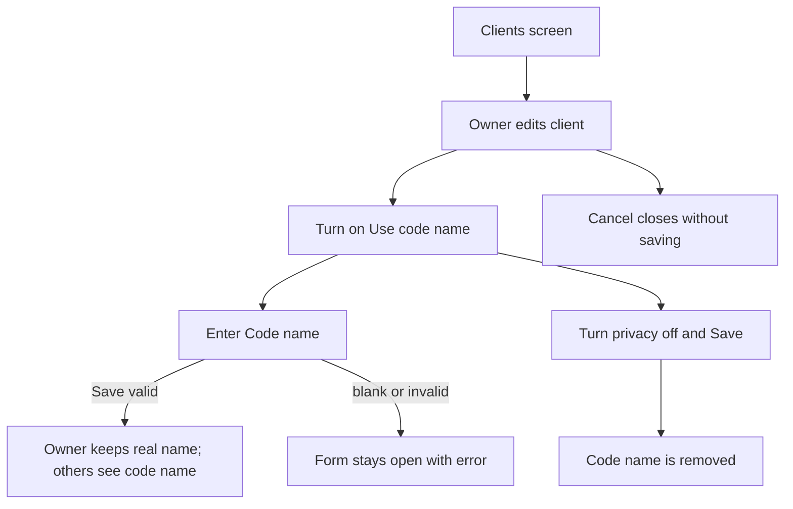
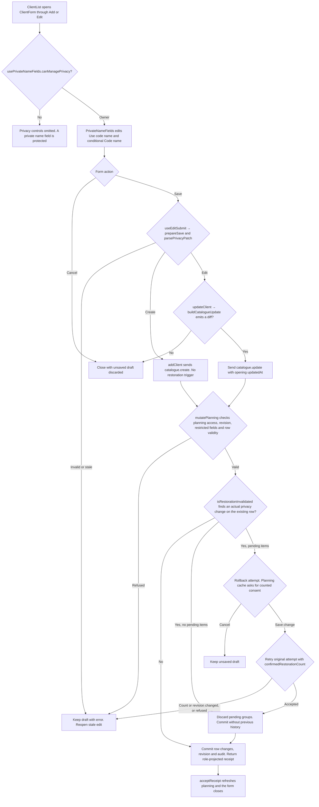

# US-CLI-05 — Mark a client private with a code name

As an Owner, I want to set a client code name so that non-Owners see the safe name while Owners retain the real name.

**Status:** Current
**Access:** Editor and above for ordinary fields; Owner only for privacy and code-name fields
**Entry:** Clients screen → client row → Edit (Owner only for private fields)
**Documentation:** [Clients and projects guide](../../docs-src/using/projects.md)
**Source:** [ClientList.tsx](../../apps/frontend/src/components/clients/ClientList.tsx) · [ClientForm.tsx](../../apps/frontend/src/components/clients/ClientForm.tsx)

## Acceptance criteria

| Field         | Control         | Required/default/conditions                                         |
| ------------- | --------------- | ------------------------------------------------------------------- |
| Name          | Text field      | Required; read-only for non-Owners when the client uses a code name |
| Use code name | Switch          | Owner only; current value prefilled                                 |
| Code name     | Text field      | Owner only; shown and required when Use code name is on             |
| Colour        | Preset swatches | Current colour preselected                                          |

- **Save** updates the real name or code name and preset colour. Non-Owners continue to see the code name. Missing code name keeps the form open with an error. **Cancel** closes without saving.

## User flow

## Code flow

Owner has the private-name controls. Editor and Admin retain ordinary edit access, and Viewer and view-as-member lack planning writes. The server independently checks both planning and private-name authority. Clearing Use code name sends a privacy reset for an existing private row. `transformState` exposes a quoted code name as the projected name to non-Owners for private rows, and the real name for public rows. A stale revision refreshes planning before the next attempt.

**Code references:** [ClientList.tsx](../../apps/frontend/src/components/clients/ClientList.tsx#L63) · [ClientForm.tsx](../../apps/frontend/src/components/clients/ClientForm.tsx#L95) · [Write controls](../../apps/frontend/src/components/common/crudButtons.tsx#L7) · [Cancel button](../../apps/frontend/src/components/common/FormButtons.tsx#L17) · [useEditSubmit.ts](../../apps/frontend/src/hooks/useEditSubmit.ts#L44) · [Row checks](../../apps/backend/app/services/planning/entity_write_service.ts#L91) · [typedPlanningActions.ts](../../apps/frontend/src/store/typedPlanningActions.ts#L185) · [planningIntents.ts](../../apps/frontend/src/data/planning/planningIntents.ts#L502) · [usePrivateNameFields.ts](../../apps/frontend/src/components/common/usePrivateNameFields.ts#L27) · [restricted_fields.ts](../../apps/backend/app/services/planning/restricted_fields.ts#L21) · [mutation_changes.ts](../../apps/backend/app/services/planning/mutation_changes.ts#L74) · [Confirmation retry](../../apps/frontend/src/data/planning/planningCache.ts#L420) · [Role projection](../../apps/backend/app/transformers/state_transformer.ts#L46) · [sendPlanningIntent](../../apps/frontend/src/store/slices/planningSessionSlice.ts#L139) · [Planning transport](../../apps/frontend/src/data/planning/planningTransport.ts#L64) · [Planning route](../../apps/backend/start/routes/planning.ts#L16) · [Mutation controller](../../apps/backend/app/controllers/planning_mutations_controller.ts#L19) · [Planning transaction](../../apps/backend/app/services/planning_service.ts#L222) · [Company write authority](../../apps/backend/app/services/planning/planning_access_service.ts#L31) · [Receipt and refresh](../../apps/frontend/src/data/planning/planningCache.ts#L469) · [restoration_pending_groups.spec.ts](../../apps/backend/tests/functional/planning/restoration_pending_batches.spec.ts#L28)
