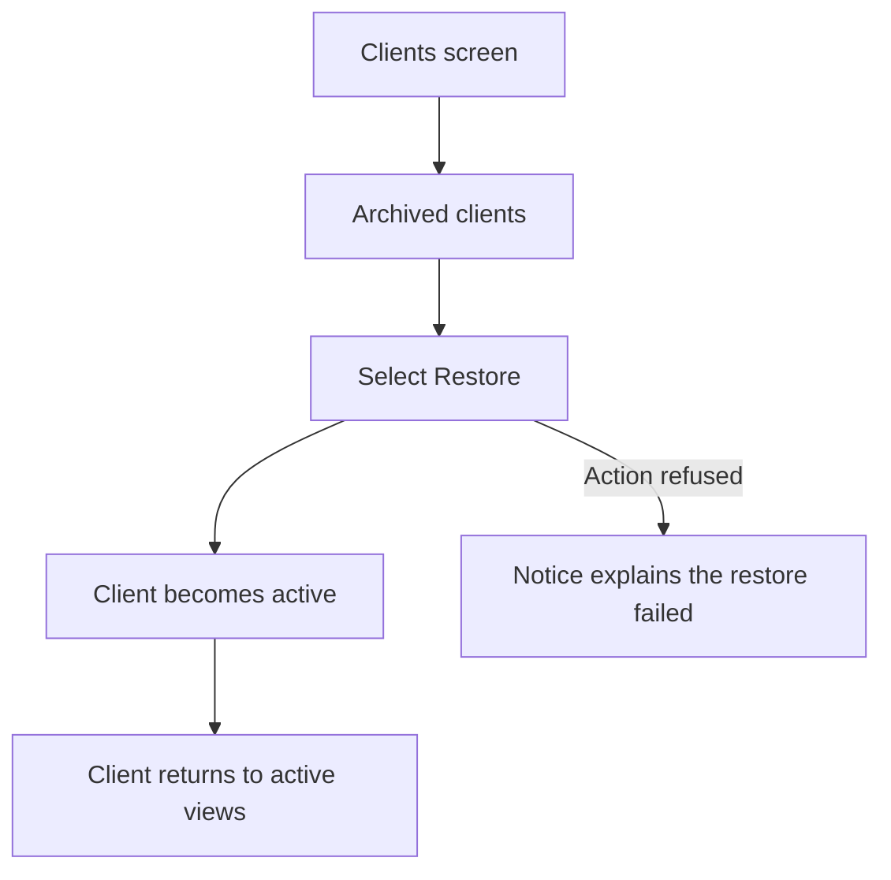
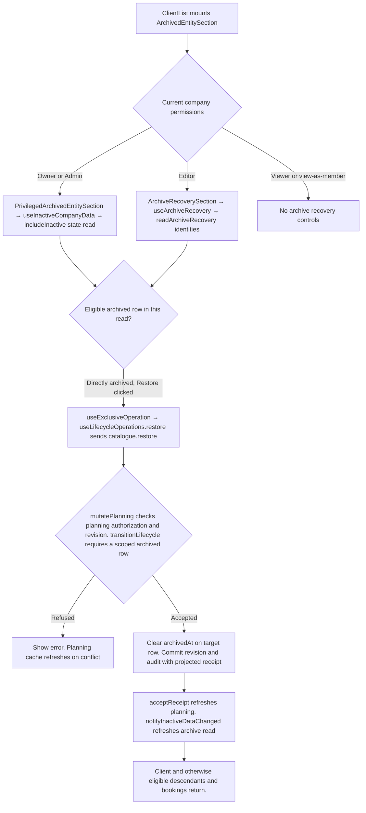

# US-CLI-06 — Restore an archived client

As an Editor, I want to restore an archived client so that its active work returns to the catalogue and schedule.

**Status:** Current
**Access:** Editor and above (Editor, Admin, Owner)
**Entry:** Clients screen → Archived clients → Restore
**Documentation:** [Clients and projects guide](../../docs-src/using/projects.md)
**Source:** [ClientList.tsx](../../apps/frontend/src/components/clients/ClientList.tsx) · [ArchivedEntitySection.tsx](../../apps/frontend/src/components/common/ArchivedEntitySection.tsx)

## Acceptance criteria

- A directly archived client has an accessible **Restore** control. Selecting it returns the client to active status and active views.
- Clients have no parent record. While a client is archived, its projects and activities appear on the Projects and Activities archived lists with **Hidden because Client {name} is archived.** and **View archived parent**, which opens this client’s archived row; restoring the client reveals those that were not archived on their own.

## User flow

## Code flow

The Editor archive read is sensitive and checks `planning:write`; it omits rows with deleted ancestry. The Owner/Admin inactive read checks `members:manage` and projects data for the effective role. An already active row is a server `E_NO_CHANGE`; a deleted row cannot be restored with this command. `endsHistory` omits the history id. A client has no catalogue ancestor. The server refuses a direct attempt to restore Internal. Restore changes only the client row, and other inactive descendants stay hidden.

**Code references:** [ClientList.tsx](../../apps/frontend/src/components/clients/ClientList.tsx#L63) · [Archive access split](../../apps/frontend/src/components/common/ArchivedEntitySection.tsx#L250) · [Editor recovery controls](../../apps/frontend/src/components/common/ArchiveRecoverySection.tsx#L27) · [Editor recovery read](../../apps/backend/app/services/planning_service.ts#L169) · [useInactiveCompanyData.ts](../../apps/frontend/src/hooks/useInactiveCompanyData.ts#L17) · [Inactive state authority](../../apps/backend/app/controllers/company_state_controller.ts#L32) · [Ancestor lookup](../../apps/frontend/src/components/common/archivedEntityRows.ts#L73) · [Editor recovery projection](../../packages/shared/src/domain/lifecycle/archiveRecovery.ts#L25) · [Editor query](../../apps/frontend/src/hooks/useArchiveRecovery.ts#L80) · [Privileged query](../../apps/frontend/src/data/fetchInactiveRecords.ts#L23) · [useLifecycleOperations.ts](../../apps/frontend/src/hooks/useLifecycleOperations.ts#L51) · [planning_execution_service.ts](../../apps/backend/app/services/planning/planning_execution_service.ts#L483) · [projection.ts](../../packages/shared/src/domain/lifecycle/projection.ts#L36) · [sendPlanningIntent](../../apps/frontend/src/store/slices/planningSessionSlice.ts#L139) · [Planning transport](../../apps/frontend/src/data/planning/planningTransport.ts#L64) · [Planning route](../../apps/backend/start/routes/planning.ts#L15) · [Mutation controller](../../apps/backend/app/controllers/planning_mutations_controller.ts#L19) · [Planning transaction](../../apps/backend/app/services/planning_service.ts#L222) · [Company write authority](../../apps/backend/app/services/planning/planning_access_service.ts#L31) · [Receipt and refresh](../../apps/frontend/src/data/planning/planningCache.ts#L469) · [archive_recovery.spec.ts](../../apps/backend/tests/functional/planning/archive_recovery.spec.ts#L353)
