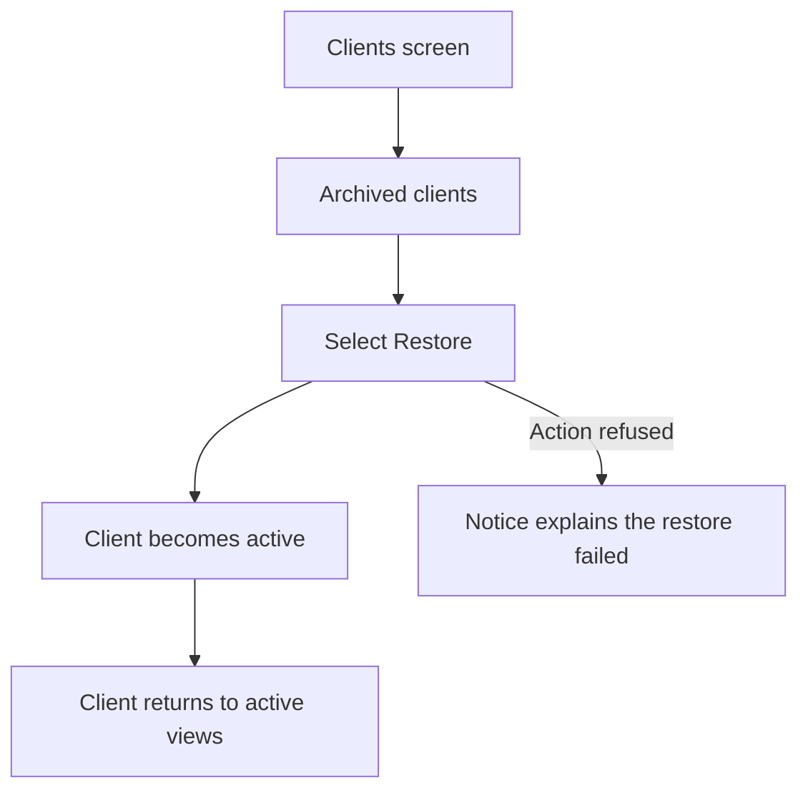
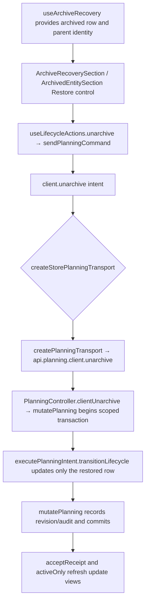

# US-CLI-06 — Restore an archived client

As an Editor, I want to restore an archived client so that its active work returns to the catalogue and schedule.

**Status:** Current
**Access:** Editor and above (Editor, Admin, Owner)
**Entry:** Clients screen → Archived clients → Restore
**Documentation:** [Clients and projects guide](../../docs-src/using/projects.md)
**Source:** [ClientList.tsx](../../apps/frontend/src/components/clients/ClientList.tsx) · [ArchivedEntitySection.tsx](../../apps/frontend/src/components/common/ArchivedEntitySection.tsx)

## Acceptance criteria

- A directly archived client has an accessible **Restore** control. Selecting it returns the client to active status and active views.
- Clients have no parent record. While a client is archived, its projects and activities appear on the Projects and Activities archived lists with **Hidden because Client {name} is archived.** and **View archived parent**, which opens this client’s archived row; restoring the client reveals those that were not archived on their own.

## User flow

## Code flow

**Code references:** [ClientList.tsx](../../apps/frontend/src/components/clients/ClientList.tsx) · [ArchivedEntitySection.tsx](../../apps/frontend/src/components/common/ArchivedEntitySection.tsx) · [ArchiveRecoverySection.tsx](../../apps/frontend/src/components/common/ArchiveRecoverySection.tsx) · [useArchiveRecovery.ts](../../apps/frontend/src/hooks/useArchiveRecovery.ts) · [useLifecycleActions.ts](../../apps/frontend/src/hooks/useLifecycleActions.ts) · [allocationSlice.ts](../../apps/frontend/src/store/slices/allocationSlice.ts) · [planningCacheController.ts](../../apps/frontend/src/data/planning/planningCacheController.ts) · [storePlanningTransport.ts](../../apps/frontend/src/data/planning/storePlanningTransport.ts) · [planningTransport.ts](../../apps/frontend/src/data/planning/planningTransport.ts) · [planning_routes.ts](../../apps/backend/start/planning_routes.ts) · [planning_controller.ts](../../apps/backend/app/controllers/planning_controller.ts) · [planning.ts](../../apps/backend/app/services/planning.ts) · [execute.ts](../../apps/backend/app/services/planning/execute.ts)
