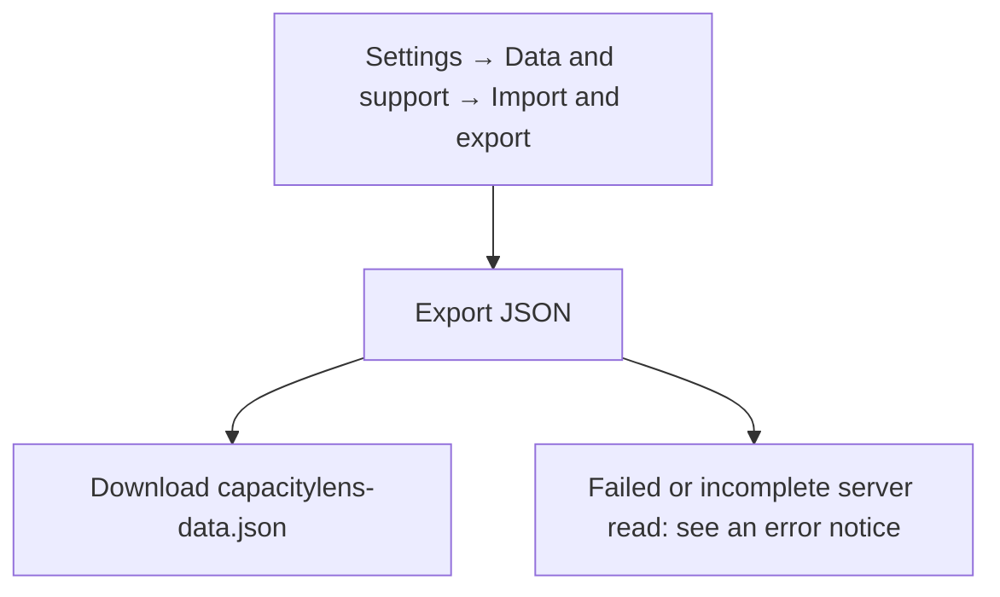
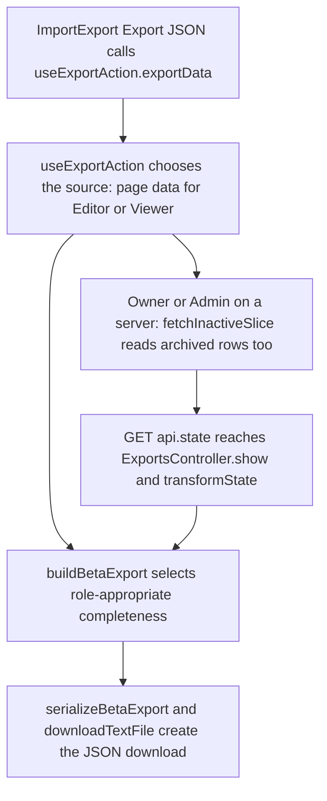

# US-DAT-01 — Export company data

As a company member, I want to export company data so that I can inspect or transfer a portable copy.

**Status:** Current
**Access:** Owner, Admin, Editor, Viewer
**Entry:** Settings → Data and support → Import and export → Export JSON
**Documentation:** [Settings](../../docs-src/using/settings.md#import-and-export)
**Source:** [ImportExport.tsx](../../apps/frontend/src/components/ImportExport.tsx)

## Acceptance criteria

- **Export JSON** downloads `capacitylens-data.json`, a beta export of the selected company.
- On a server, Owner and Admin exports reload the company including archived records; Editor and Viewer exports contain the active records already loaded in the page. Owners get real private names; other roles get the code names they see.
- The export excludes identities, memberships, sessions, admission records and device preferences.

## User flow

## Code flow

**Code references:** [ImportExport.tsx](../../apps/frontend/src/components/ImportExport.tsx), [useExportAction.ts](../../apps/frontend/src/components/import-export/useExportAction.ts), [fetchInactiveSlice.ts](../../apps/frontend/src/data/fetchInactiveSlice.ts), [export_routes.ts](../../apps/backend/start/export_routes.ts), [exports_controller.ts](../../apps/backend/app/controllers/exports_controller.ts), [state_transformer.ts](../../apps/backend/app/transformers/state_transformer.ts), [betaTransfer.ts](../../packages/shared/src/data/betaTransfer.ts), [download.ts](../../apps/frontend/src/lib/download.ts)
