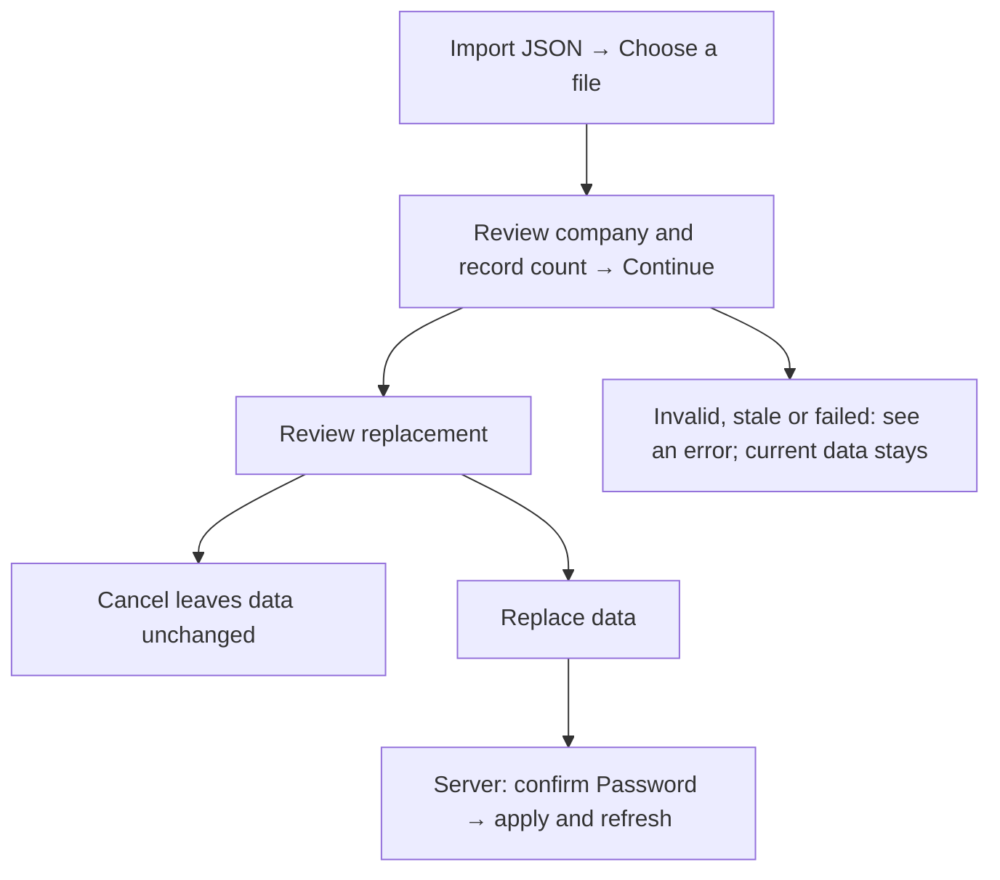
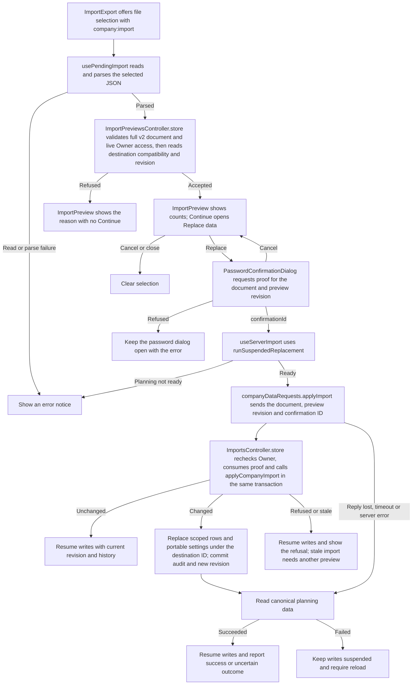

# US-DAT-02 — Preview and replace company data

As an Owner, I want to preview and replace company data so that I can restore a valid full export into this company.

**Status:** Current
**Access:** Owner
**Entry:** Settings → Data and support → Import and export → Import JSON
**Documentation:** [Settings](../../docs-src/using/settings.md#import-and-export)
**Source:** [ImportExport.tsx](../../apps/frontend/src/components/ImportExport.tsx), [ImportPreview.tsx](../../apps/frontend/src/components/import-export/ImportPreview.tsx), [PasswordConfirmationDialog.tsx](../../apps/frontend/src/auth/PasswordConfirmationDialog.tsx)

## Acceptance criteria

| Field       | Control                                | Required/default/conditions                                                                                  |
| ----------- | -------------------------------------- | ------------------------------------------------------------------------------------------------------------ |
| Import JSON | JSON file chooser                      | Shown to the Owner; accepts application/json; requires a full CapacityLens beta export with schema version 2 |
| Password    | Password input in **Confirm it’s you** | Server only; the Owner’s current password                                                                    |

Choosing a file has the server check it and opens **Import data?** with the server's reason for refusing it, or with "{count} planning records for {company}. Entity IDs and company settings are preserved." and **Continue**; closing it changes nothing. A second **Import data?** dialog reads "Import {file} — this replaces this company’s data with {record counts}." followed by "This cannot be undone." and offers **Replace data** and **Cancel**. Replace data opens **Confirm it’s you**, where **Continue** applies the import and **Cancel** returns to the previous dialog.

- Cancel, invalid input or a stale revision leaves data unchanged. Import is Owner-only.

## User flow

## Code flow

The current replacement writes the portable company settings, including time zone and week start. The [ordinary company edit guard](../../apps/backend/app/services/planning/entity_rules.ts#L235) is a separate path.

**Code references:** [ImportExport.tsx](../../apps/frontend/src/components/ImportExport.tsx#L202) · [useServerImport.ts](../../apps/frontend/src/components/import-export/useServerImport.ts#L46) · [suspendedReplacement.ts](../../apps/frontend/src/store/suspendedReplacement.ts#L54) · [import_previews_controller.ts](../../apps/backend/app/controllers/import_previews_controller.ts#L9) · [imports_controller.ts](../../apps/backend/app/controllers/imports_controller.ts#L10) · [company_import.ts](../../apps/backend/app/services/company_import.ts#L136) · [Portable company fields](../../packages/shared/src/data/companyExport.fields.ts#L13) · [Scope rebinding](../../packages/shared/src/data/companyExport.ts#L173) · [import_apply.spec.ts](../../apps/backend/tests/functional/import_apply.spec.ts#L93)
