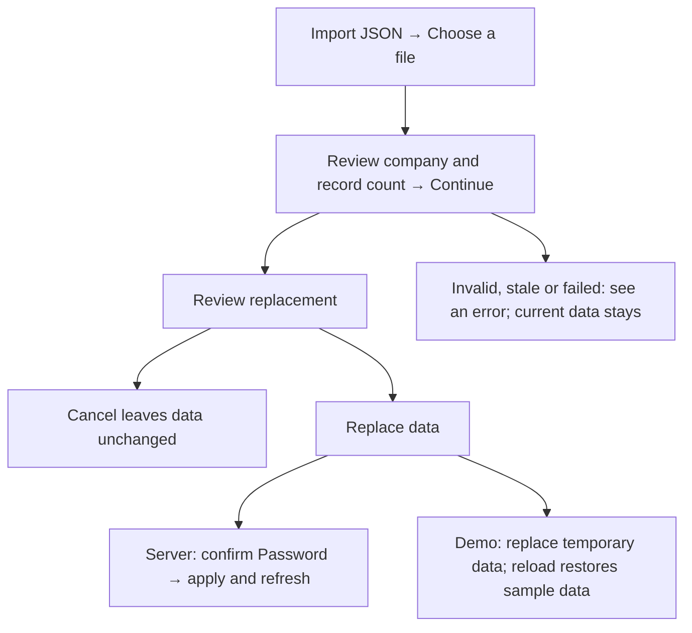
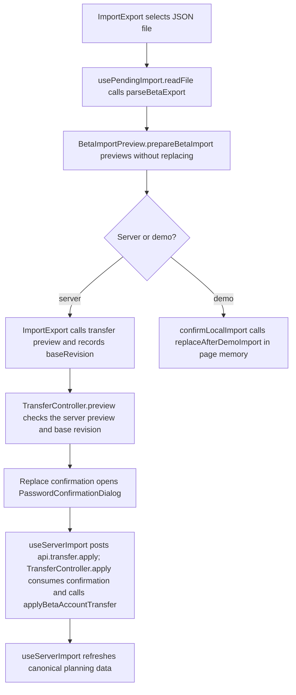

# US-DAT-02 — Preview and replace company data

As an Owner, I want to preview and replace company data so that I can restore a valid full export into this company.

**Status:** Current
**Access:** Owner on server; demo users in temporary demo
**Entry:** Settings → Data and support → Import and export → Import JSON
**Documentation:** [Settings](../../docs-src/using/settings.md#import-and-export)
**Source:** [ImportExport.tsx](../../apps/frontend/src/components/ImportExport.tsx), [BetaImportPreview.tsx](../../apps/frontend/src/components/import-export/BetaImportPreview.tsx), [PasswordConfirmationDialog.tsx](../../apps/frontend/src/auth/PasswordConfirmationDialog.tsx)

## Acceptance criteria

| Field       | Control                                | Required/default/conditions                                                                                                                       |
| ----------- | -------------------------------------- | ------------------------------------------------------------------------------------------------------------------------------------------------- |
| Import JSON | JSON file chooser                      | Shown to the Owner on a server and to anyone in demo mode; accepts application/json; the file must be a complete beta v1 export from this product |
| Password    | Password input in **Confirm it’s you** | Server only; the Owner’s current password                                                                                                         |

Choosing a file opens **Import data?** with "{count} planning records for {company}. Entity IDs and company settings are preserved." and **Continue**; closing it changes nothing. On a server, Continue first has the server check the file. A second **Import data?** dialog reads "Import {file} — this replaces this company’s data with {record counts}." (on a server, followed by "This cannot be undone.") and offers **Replace data** and **Cancel**. In demo mode Replace data applies the file; on a server it opens **Confirm it’s you**, where **Continue** applies the import and **Cancel** returns to the previous dialog.

- Cancel, invalid input or a stale revision leaves data unchanged. Server import is Owner-only; demo import stays temporary.

## User flow

## Code flow

**Code references:** [ImportExport.tsx](../../apps/frontend/src/components/ImportExport.tsx), [usePendingImport.ts](../../apps/frontend/src/components/import-export/usePendingImport.ts), [BetaImportPreview.tsx](../../apps/frontend/src/components/import-export/BetaImportPreview.tsx), [useServerImport.ts](../../apps/frontend/src/components/import-export/useServerImport.ts), [confirmLocalImport.ts](../../apps/frontend/src/components/import-export/confirmLocalImport.ts), [PasswordConfirmationDialog.tsx](../../apps/frontend/src/auth/PasswordConfirmationDialog.tsx), [transfer_routes.ts](../../apps/backend/start/transfer_routes.ts), [transfer_controller.ts](../../apps/backend/app/controllers/transfer_controller.ts), [beta_account_transfer.ts](../../apps/backend/app/services/beta_account_transfer.ts), [allocationSlice.ts](../../apps/frontend/src/store/slices/allocationSlice.ts)
