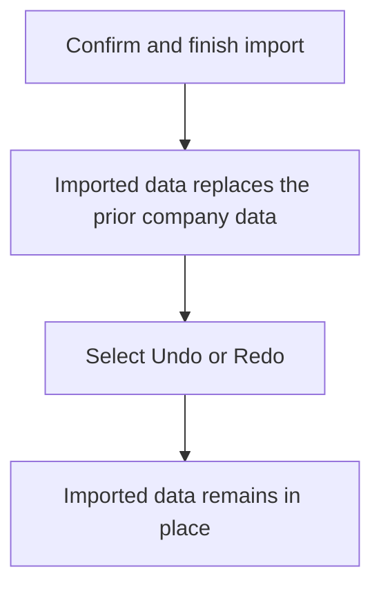
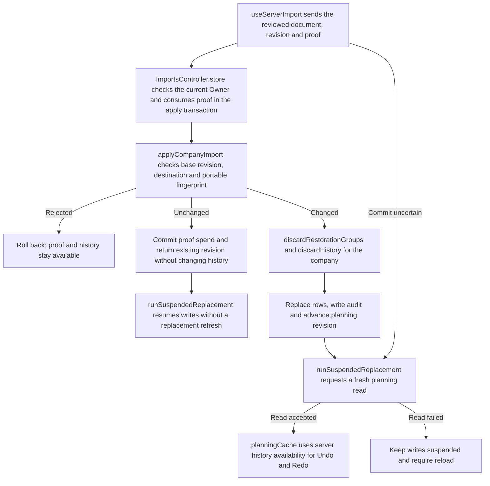

# US-DAT-03 — Keep imported data outside undo history

As an Owner, I want imports to stay outside undo history so that an accidental undo cannot replace imported company data.

**Status:** Current
**Access:** Owner
**Entry:** After import → Undo/Redo
**Documentation:** [Settings](../../docs-src/using/settings.md#beta-import-contract)
**Source:** [ImportExport.tsx](../../apps/frontend/src/components/ImportExport.tsx)

## Acceptance criteria

- Completing an import clears the Undo and Redo history, so neither can reverse the import or any earlier change.

## User flow

## Code flow

**Code references:** [useServerImport.ts](../../apps/frontend/src/components/import-export/useServerImport.ts#L46) · [imports_controller.ts](../../apps/backend/app/controllers/imports_controller.ts#L30) · [company_import_service.ts](../../apps/backend/app/services/company_import_service.ts#L145) · [suspendedReplacement.ts](../../apps/frontend/src/store/suspendedReplacement.ts#L101) · [planningCache.ts](../../apps/frontend/src/data/planning/planningCache.ts#L224) · [import_apply.spec.ts](../../apps/backend/tests/functional/import_apply.spec.ts#L194) · [import_apply.spec.ts](../../apps/backend/tests/functional/import_apply.spec.ts#L262)
