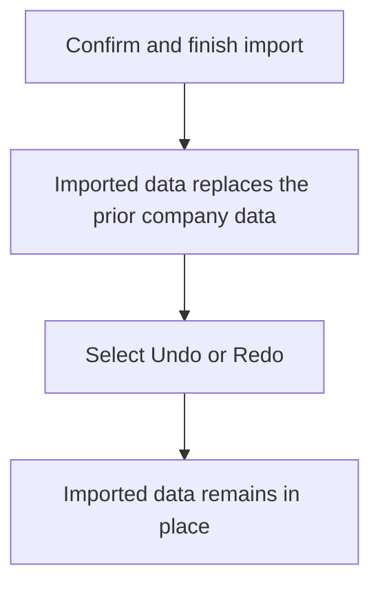
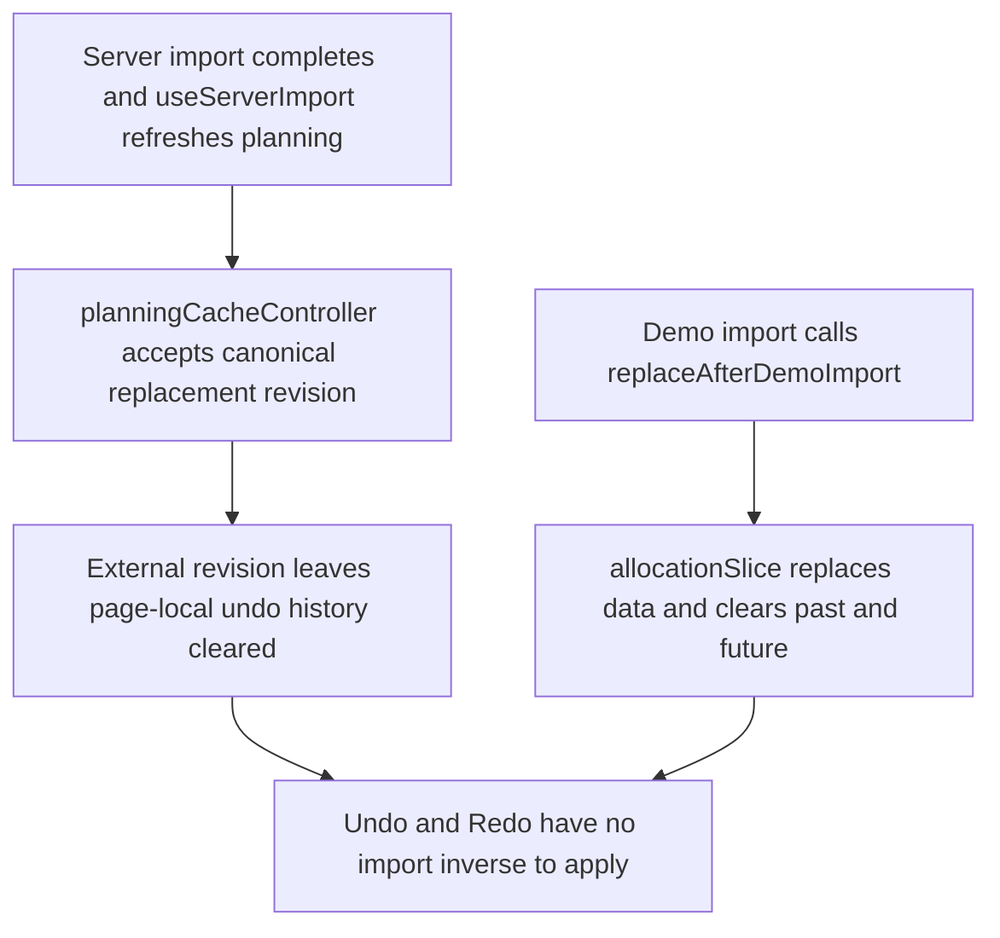

# US-DAT-03 — Keep imported data outside undo history

As an Owner, I want imports to stay outside undo history so that an accidental undo cannot replace imported company data.

**Status:** Current
**Access:** Owner on server; demo users in temporary demo
**Entry:** After import → Undo/Redo
**Documentation:** [Settings](../../docs-src/using/settings.md#beta-transfer-contract)
**Source:** [ImportExport.tsx](../../apps/frontend/src/components/ImportExport.tsx)

## Acceptance criteria

- A confirmed import has no page-local inverse.
- Undo and Redo leave the imported company data in place.

## User flow

## Code flow

**Code references:** [useServerImport.ts](../../apps/frontend/src/components/import-export/useServerImport.ts), [planningCacheController.ts](../../apps/frontend/src/data/planning/planningCacheController.ts), [allocationSlice.ts](../../apps/frontend/src/store/slices/allocationSlice.ts), [ImportExport.tsx](../../apps/frontend/src/components/ImportExport.tsx)
