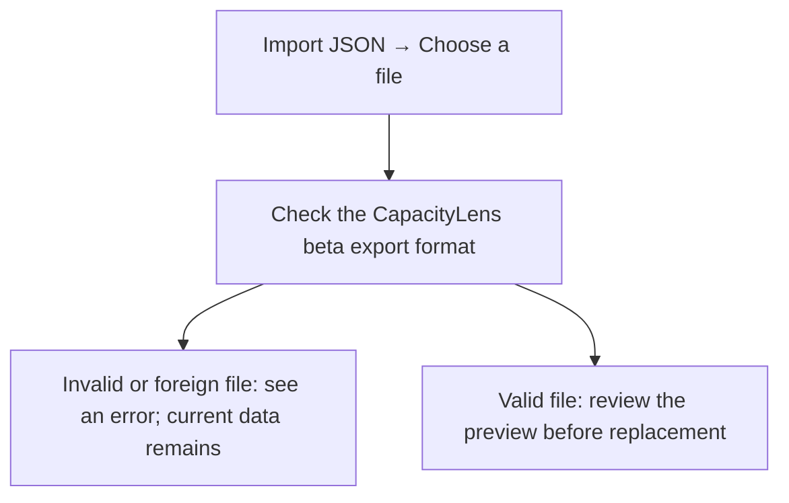
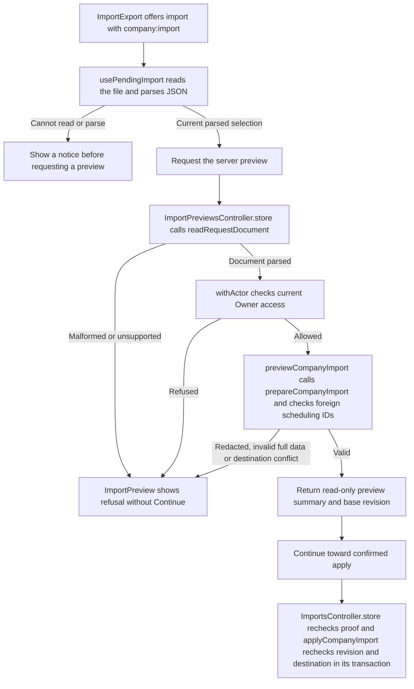

# US-DAT-04 — Reject invalid import files

As a company member, I want invalid import files rejected so that an accidental selection cannot replace my data.

**Status:** Current
**Access:** Owner
**Entry:** Settings → Data and support → Import and export → Import JSON
**Documentation:** [Settings](../../docs-src/using/settings.md#import-and-export)
**Source:** [ImportExport.tsx](../../apps/frontend/src/components/ImportExport.tsx)

## Acceptance criteria

- The importer accepts only a full (not redacted) `capacitylens-beta` schema version 2 export whose records all pass validation.
- A file that is not valid JSON or fails these checks is refused with an error before anything is replaced; current company data remains intact.

## User flow

## Code flow

See [Preview and replace company data](US-DAT-02-import-json.md#code-flow) for the apply outcomes.

**Code references:** [ImportExport.tsx](../../apps/frontend/src/components/ImportExport.tsx#L160) · [usePendingImport.ts](../../apps/frontend/src/components/import-export/usePendingImport.ts#L32) · [ImportPreview.tsx](../../apps/frontend/src/components/import-export/ImportPreview.tsx#L14) · [import_previews_controller.ts](../../apps/backend/app/controllers/import_previews_controller.ts#L25) · [company_import_service.ts](../../apps/backend/app/services/company_import_service.ts#L145) · [companyExport.ts](../../packages/shared/src/data/companyExport.ts#L161) · [import_apply.spec.ts](../../apps/backend/tests/functional/import_apply.spec.ts#L147) · [import_apply.spec.ts](../../apps/backend/tests/functional/import_apply.spec.ts#L168)
