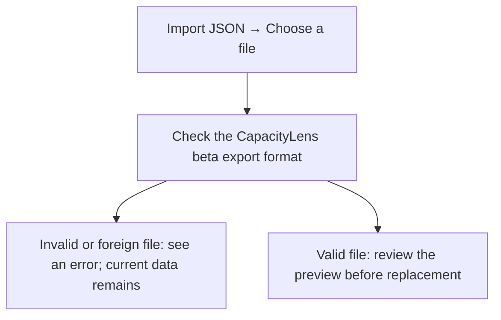
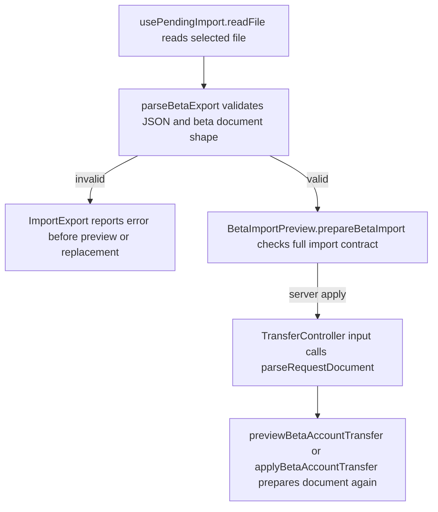

# US-DAT-04 — Reject invalid import files

As a company member, I want invalid import files rejected so that an accidental selection cannot replace my data.

**Status:** Current
**Access:** Owner
**Entry:** Settings → Data and support → Import and export → Import JSON
**Documentation:** [Settings](../../docs-src/using/settings.md#import-and-export)
**Source:** [ImportExport.tsx](../../apps/frontend/src/components/ImportExport.tsx)

## Acceptance criteria

- The importer accepts only a full (not redacted) `capacitylens-beta` schema version 1 export whose records all pass validation.
- A file that is not valid JSON or fails these checks is refused with an error before anything is replaced; current company data remains intact.

## User flow

## Code flow

**Code references:** [ImportExport.tsx](../../apps/frontend/src/components/ImportExport.tsx), [usePendingImport.ts](../../apps/frontend/src/components/import-export/usePendingImport.ts), [BetaImportPreview.tsx](../../apps/frontend/src/components/import-export/BetaImportPreview.tsx), [betaTransfer.ts](../../packages/shared/src/data/betaTransfer.ts), [transfer_controller.ts](../../apps/backend/app/controllers/transfer_controller.ts), [beta_account_transfer.ts](../../apps/backend/app/services/beta_account_transfer.ts)
