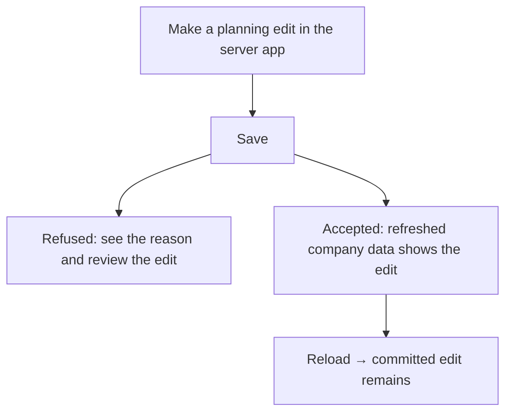
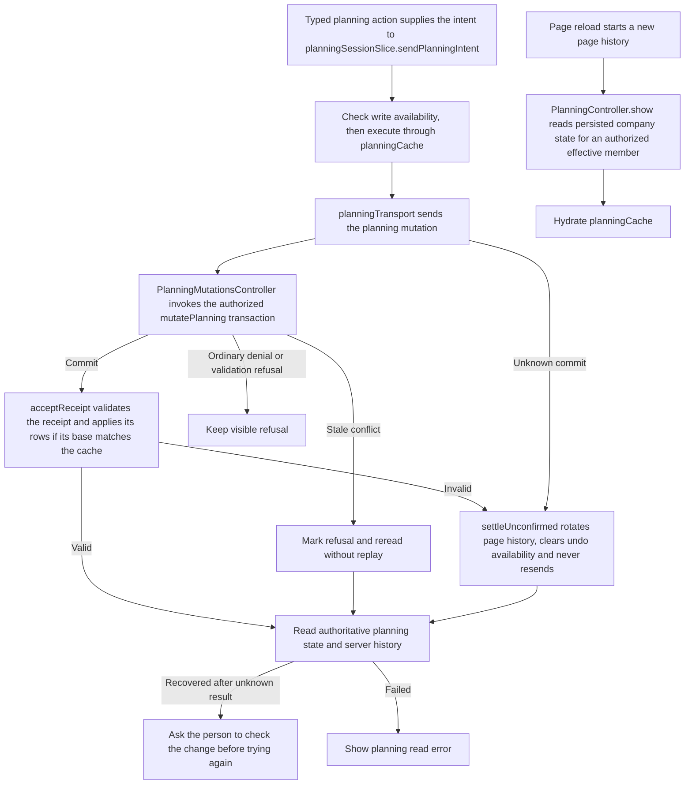

# US-DAT-05 — Keep server changes after reload

As a company member, I want saved server changes to persist after reload so that committed work remains available.

**Status:** Current
**Access:** Any authorised company member
**Entry:** Any saved planning edit
**Documentation:** [Settings](../../docs-src/using/settings.md#connection-errors)
**Source:** [planningCache.ts](../../apps/frontend/src/data/planning/planningCache.ts)

## Acceptance criteria

- A committed server change remains after a reload.
- Stale writes are refused and refreshed for review. A change whose reply was lost is never resent: the schedule shows the server's data and asks the person to check the change.

## User flow

## Code flow

**Code references:** [typedPlanningActions.ts](../../apps/frontend/src/store/typedPlanningActions.ts#L87) · [planningSessionSlice.ts](../../apps/frontend/src/store/slices/planningSessionSlice.ts#L139) · [planningCache.ts](../../apps/frontend/src/data/planning/planningCache.ts#L469) · [planningCache.ts](../../apps/frontend/src/data/planning/planningCache.ts#L525) · [planning_service.ts](../../apps/backend/app/services/planning_service.ts#L270) · [planning_controller.ts](../../apps/backend/app/controllers/planning_controller.ts#L9) · [planning_access_service.ts](../../apps/backend/app/services/planning/planning_access_service.ts#L31) · [dev-fullstack.mjs](../../scripts/dev/dev-fullstack.mjs#L124)
