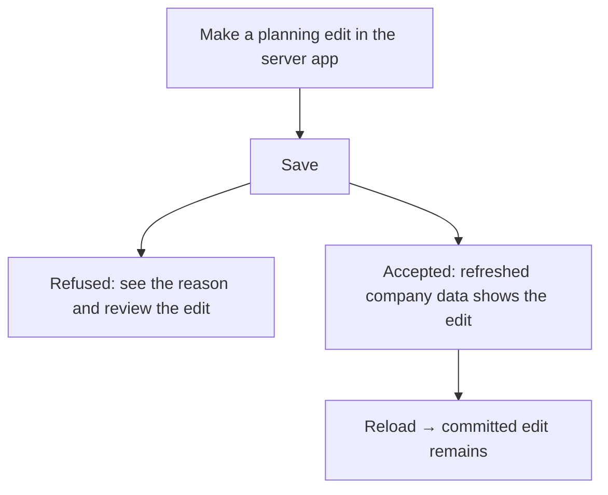
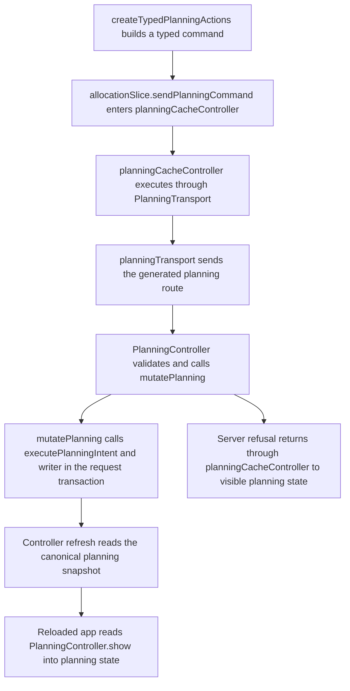

# US-DAT-05 — Keep server changes after reload

As a company member, I want saved server changes to persist after reload so that committed work remains available.

**Status:** Current
**Access:** Any authorized company member
**Entry:** Any saved planning edit
**Documentation:** [Settings](../../docs-src/using/settings.md#connection-errors)
**Source:** [planningCacheController.ts](../../apps/frontend/src/data/planning/planningCacheController.ts)

## Acceptance criteria

- A committed server change remains after a reload.
- Stale writes are refused and refreshed for review; uncertain outcomes are checked before retry.

## User flow

## Code flow

**Code references:** [typedPlanningActions.ts](../../apps/frontend/src/store/typedPlanningActions.ts), [allocationSlice.ts](../../apps/frontend/src/store/slices/allocationSlice.ts), [planningCacheController.ts](../../apps/frontend/src/data/planning/planningCacheController.ts), [planningTransport.ts](../../apps/frontend/src/data/planning/planningTransport.ts), [planning_controller.ts](../../apps/backend/app/controllers/planning_controller.ts), [planning.ts](../../apps/backend/app/services/planning.ts), [execute.ts](../../apps/backend/app/services/planning/execute.ts), [writer.ts](../../apps/backend/app/services/planning/writer.ts)
