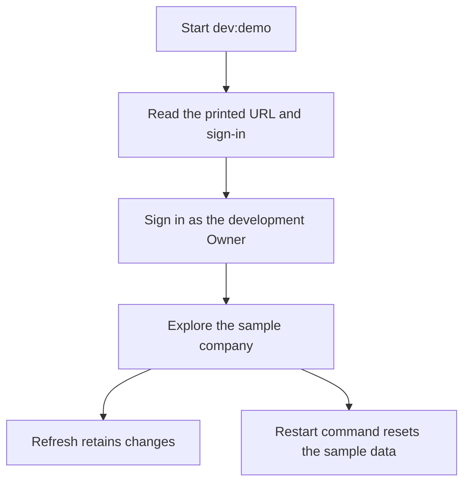
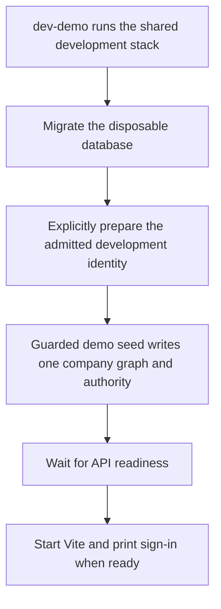

# US-DAT-06 — Explore disposable sample data

As an evaluator, I want to explore a sample company on the real server so that I can try the same planning and permission behavior as an installation.

**Status:** Demo
**Access:** Printed development Owner sign-in
**Entry:** `pnpm run dev:demo` → sign in → sample company
**Documentation:** [Try the demo](../../docs-src/getting-started/try-the-demo.md)
**Source:** [dev-demo.mjs](../../scripts/dev-demo.mjs); [disposable_demo.ts](../../apps/backend/app/services/disposable_demo.ts)

## Acceptance criteria

- The command starts the full stack with one sample company on disposable SQLite storage and prints the development credentials.
- Changes survive refresh and reset when the command restarts.
- Normal development and installation never automatically grant company ownership or add sample data.
- Preparation and seeding refuse production and nonempty company or membership storage. Seeding independently requires the admitted development identity.
- Sample rows, the Owner membership, planning revision and initialization audit commit together.

## User flow

## Code flow

**Code references:** [dev-fullstack.mjs](../../scripts/dev-fullstack.mjs); [demo_prepare.ts](../../apps/backend/commands/demo_prepare.ts); [demo_seed.ts](../../apps/backend/commands/demo_seed.ts); [development_bootstrap.ts](../../apps/backend/app/services/development_bootstrap.ts); [initial_company_authority.ts](../../apps/backend/app/services/initial_company_authority.ts); [disposable_demo.spec.ts](../../apps/backend/tests/functional/auth/disposable_demo.spec.ts)
