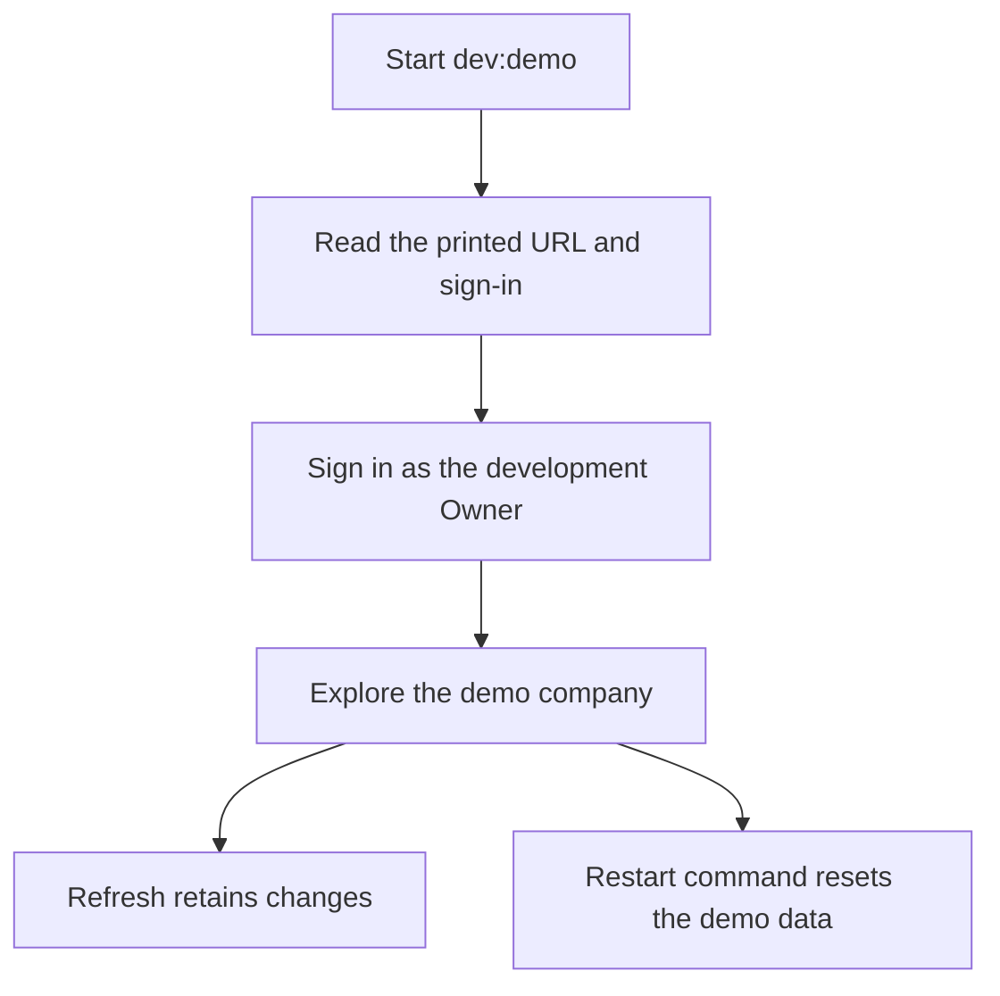
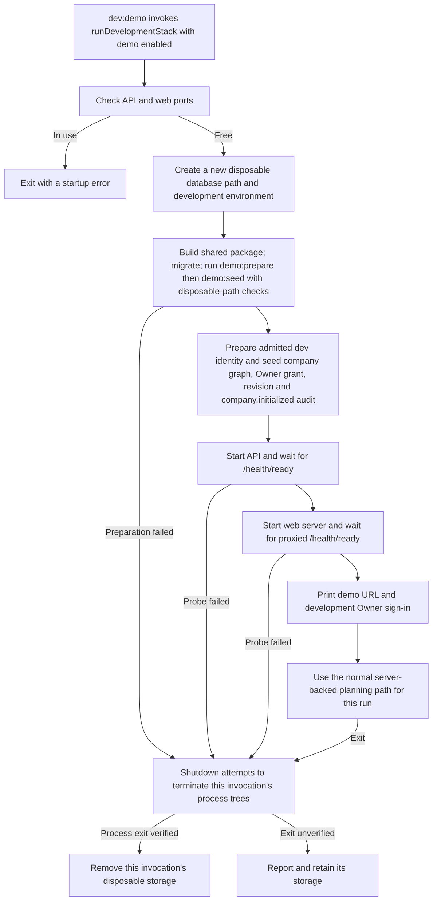

# US-DAT-06 — Explore disposable demo data

As an evaluator, I want to explore a demo company on the real server so that I can try the same planning and permission behaviour as an installation.

**Status:** Demo
**Access:** Printed development Owner sign-in
**Entry:** `pnpm run dev:demo` → sign in → demo company
**Documentation:** [Try the demo](../../docs-src/getting-started/try-the-demo.md)
**Source:** [dev-demo.mjs](../../scripts/dev/dev-demo.mjs); [disposable_demo_service.ts](../../apps/backend/app/services/disposable_demo_service.ts)

## Acceptance criteria

- The command starts the full stack with one demo company on disposable SQLite storage and prints the development credentials.
- Changes survive refresh and reset when the command restarts.
- Normal development and installation never automatically grant company ownership or add demo data.
- Preparation and seeding refuse production and nonempty company or membership storage. Seeding independently requires the admitted development identity.
- Demo rows, the Owner membership, planning revision and initialisation audit commit together.

## User flow

## Code flow

**Code references:** [dev-fullstack.mjs](../../scripts/dev/dev-fullstack.mjs#L38) · [dev-fullstack.mjs](../../scripts/dev/dev-fullstack.mjs#L61) · [dev-fullstack.mjs](../../scripts/dev/dev-fullstack.mjs#L124) · [demo_prepare.ts](../../apps/backend/commands/demo_prepare.ts#L12) · [demo_seed.ts](../../apps/backend/commands/demo_seed.ts#L12) · [disposable_demo_service.ts](../../apps/backend/app/services/disposable_demo_service.ts#L49) · [initial_company_access_service.ts](../../apps/backend/app/services/initial_company_access_service.ts#L7) · [disposable_demo.spec.ts](../../apps/backend/tests/functional/auth/disposable_demo.spec.ts#L109)
