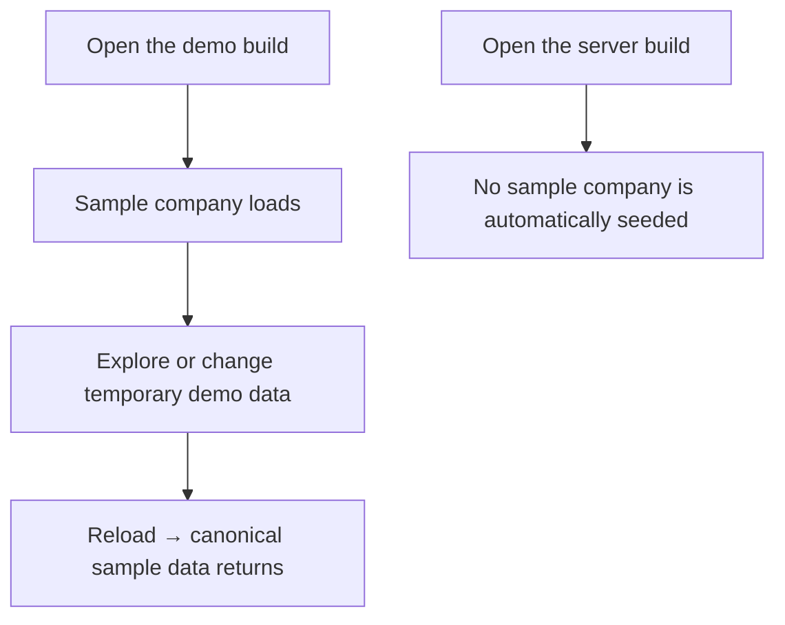
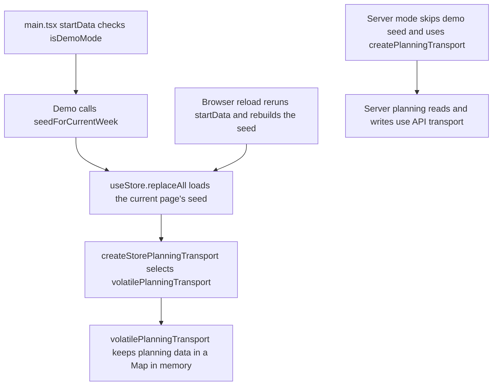

# US-DAT-06 — Explore temporary demo data

As a demo user, I want to explore temporary demo data so that I can try the product without creating durable company data.

**Status:** Demo
**Access:** Demo user
**Entry:** Open in-memory demo → choose company
**Documentation:** [Settings](../../docs-src/using/settings.md)
**Source:** [fakeAuth.ts](../../apps/frontend/src/lib/fakeAuth.ts)

## Acceptance criteria

- Demo changes last only for the open page.
- Reload restores the canonical demo seed; real server data is not automatically seeded.

## User flow

## Code flow

**Code references:** [main.tsx](../../apps/frontend/src/main.tsx), [apiConfig.ts](../../apps/frontend/src/data/apiConfig.ts), [seed.ts](../../packages/shared/src/data/seed.ts), [useStore.ts](../../apps/frontend/src/store/useStore.ts), [storePlanningTransport.ts](../../apps/frontend/src/data/planning/storePlanningTransport.ts), [volatilePlanningTransport.ts](../../apps/frontend/src/data/planning/volatilePlanningTransport.ts), [planningTransport.ts](../../apps/frontend/src/data/planning/planningTransport.ts)
