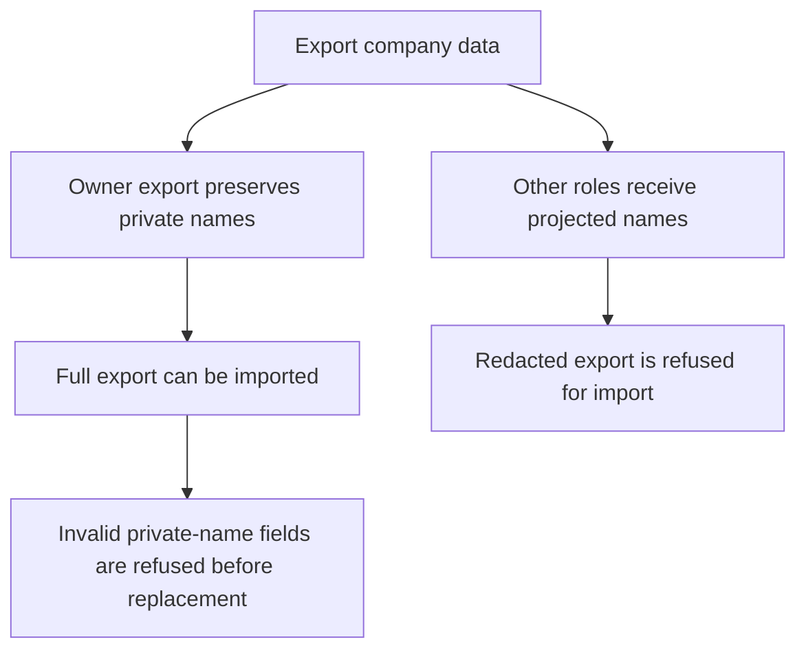
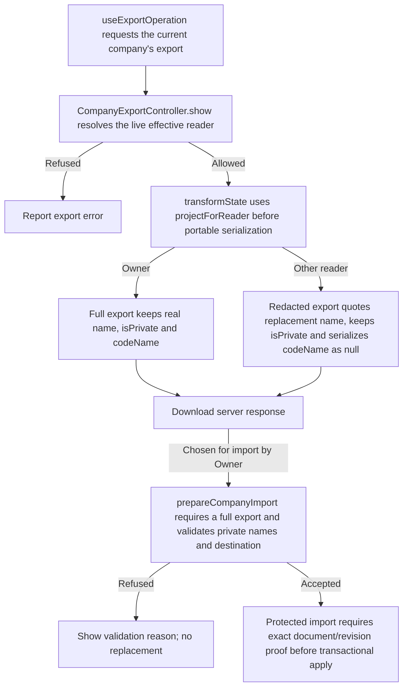

# US-DAT-07 — Preserve private names safely in export and import

As an Owner, I want private names preserved safely in export and import so that confidential identities remain protected and restorable.

**Status:** Current
**Access:** Owner for import; role-tiered export
**Entry:** Settings → Data and support → Import and export
**Documentation:** [Settings](../../docs-src/using/settings.md#import-and-export)
**Source:** [company_import_service.ts](../../apps/backend/app/services/company_import_service.ts)

## Acceptance criteria

- Owner exports keep each private client’s or project’s real name and code name, so they can be imported. Other roles’ exports are marked redacted: a private record’s name is replaced by its quoted code name and the separate code name is left empty.
- A redacted export cannot replace company data; invalid private fields are rejected.

## User flow

## Code flow

See [Confirm the exact import operation](US-DAT-08-preview-exact-import.md#code-flow) for the apply proof and outcomes.

**Code references:** [company_exports_controller.ts](../../apps/backend/app/controllers/company_export_controller.ts#L35) · [restricted_fields.ts](../../apps/backend/app/services/planning/restricted_fields.ts#L21) · [privateNames.ts](../../packages/shared/src/domain/privateNames.ts#L64) · [companyExport.ts](../../packages/shared/src/data/companyExport.ts#L104) · [companyExport.ts](../../packages/shared/src/data/companyExport.ts#L161) · [imports_controller.ts](../../apps/backend/app/controllers/imports_controller.ts#L30) · [company_export.spec.ts](../../apps/backend/tests/functional/company_export.spec.ts#L71) · [import_apply.spec.ts](../../apps/backend/tests/functional/import_apply.spec.ts#L410)
