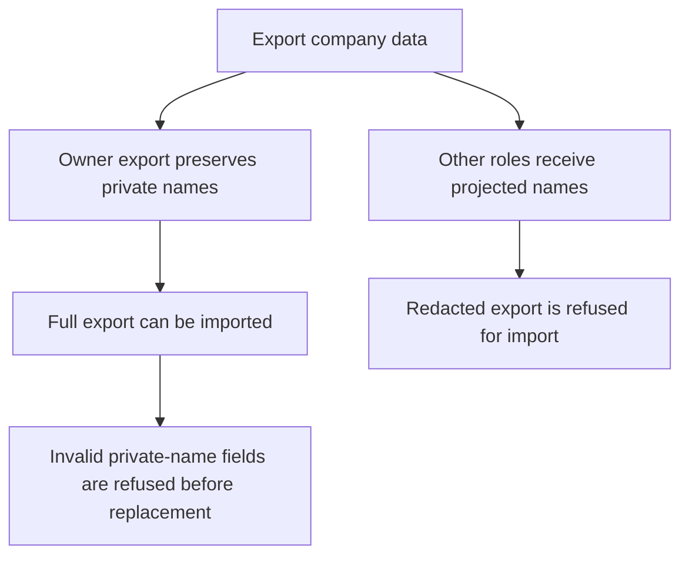
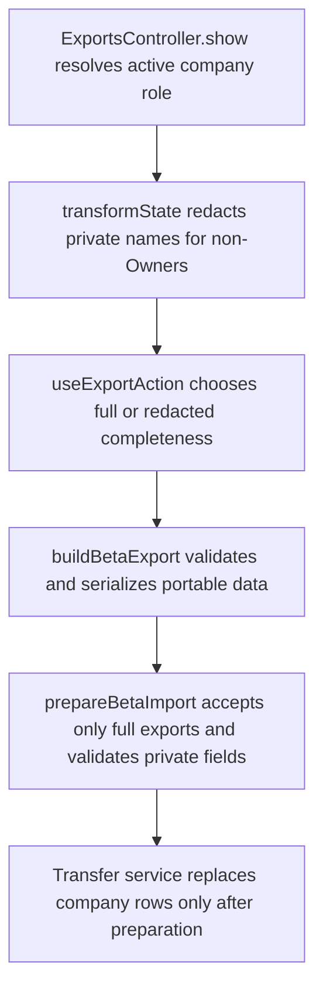

# US-DAT-07 — Preserve private names safely in transfer

As an Owner, I want private names preserved safely in export and import so that confidential identities remain protected and restorable.

**Status:** Current
**Access:** Owner for import; role-tiered export
**Entry:** Settings → Import and export
**Documentation:** [Settings](../../docs-src/using/settings.md#import-and-export)
**Source:** [beta_account_transfer.ts](../../apps/backend/app/services/beta_account_transfer.ts)

## Acceptance criteria

- Owner exports preserve private names for full-fidelity restore; other roles receive projected names without raw code names.
- A redacted export cannot replace company data; invalid private fields are rejected.

## User flow

## Code flow

**Code references:** [useExportAction.ts](../../apps/frontend/src/components/import-export/useExportAction.ts), [fetchInactiveSlice.ts](../../apps/frontend/src/data/fetchInactiveSlice.ts), [exports_controller.ts](../../apps/backend/app/controllers/exports_controller.ts), [state_transformer.ts](../../apps/backend/app/transformers/state_transformer.ts), [privateNames.ts](../../packages/shared/src/domain/privateNames.ts), [betaTransfer.ts](../../packages/shared/src/data/betaTransfer.ts), [beta_account_transfer.ts](../../apps/backend/app/services/beta_account_transfer.ts)
