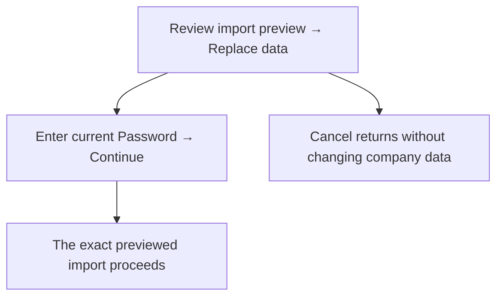
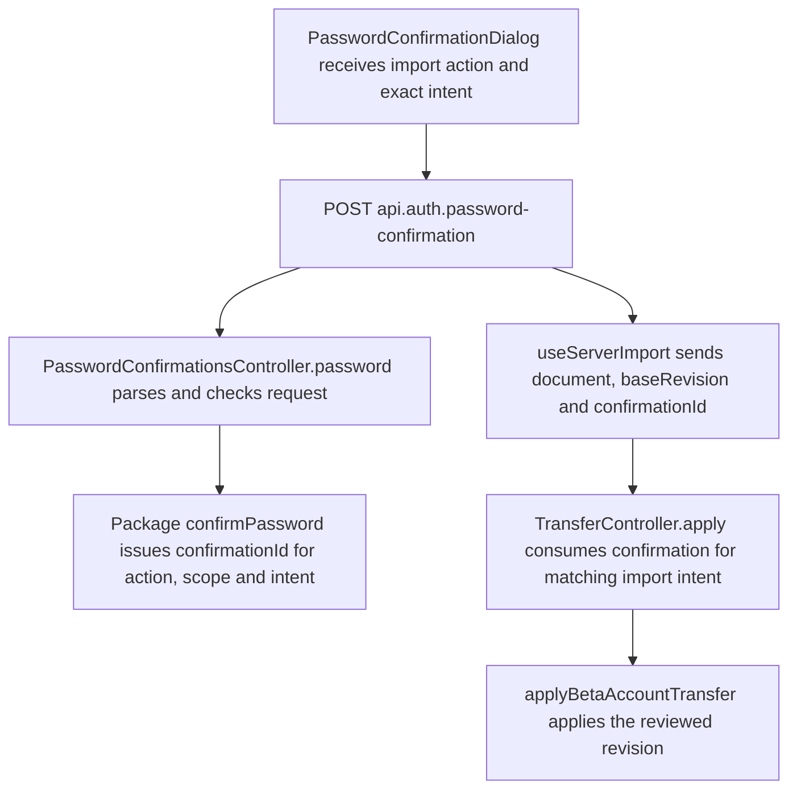

# US-DAT-08 — Confirm the exact import operation

As an Owner, I want to confirm the exact import operation so that my password cannot authorize a different replacement.

**Status:** Current
**Access:** Owner
**Entry:** Import preview → Replace data → password confirmation
**Documentation:** [Settings](../../docs-src/using/settings.md#import-and-export)
**Source:** [ImportExport.tsx](../../apps/frontend/src/components/ImportExport.tsx)

## Acceptance criteria

- Use the **Password** field in [Import company data](US-DAT-02-import-json.md). **Continue** confirms this previewed import; **Cancel** leaves the data unchanged.

## User flow

## Code flow

**Code references:** [ImportExport.tsx](../../apps/frontend/src/components/ImportExport.tsx), [PasswordConfirmationDialog.tsx](../../apps/frontend/src/auth/PasswordConfirmationDialog.tsx), [useServerImport.ts](../../apps/frontend/src/components/import-export/useServerImport.ts), [auth_routes.ts](../../apps/backend/start/auth_routes.ts), [password_confirmations_controller.ts](../../apps/backend/app/controllers/password_confirmations_controller.ts), [transfer_routes.ts](../../apps/backend/start/transfer_routes.ts), [transfer_controller.ts](../../apps/backend/app/controllers/transfer_controller.ts), [beta_account_transfer.ts](../../apps/backend/app/services/beta_account_transfer.ts)
