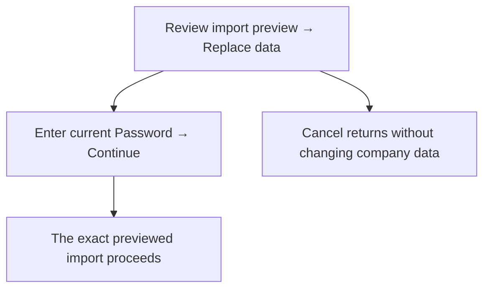
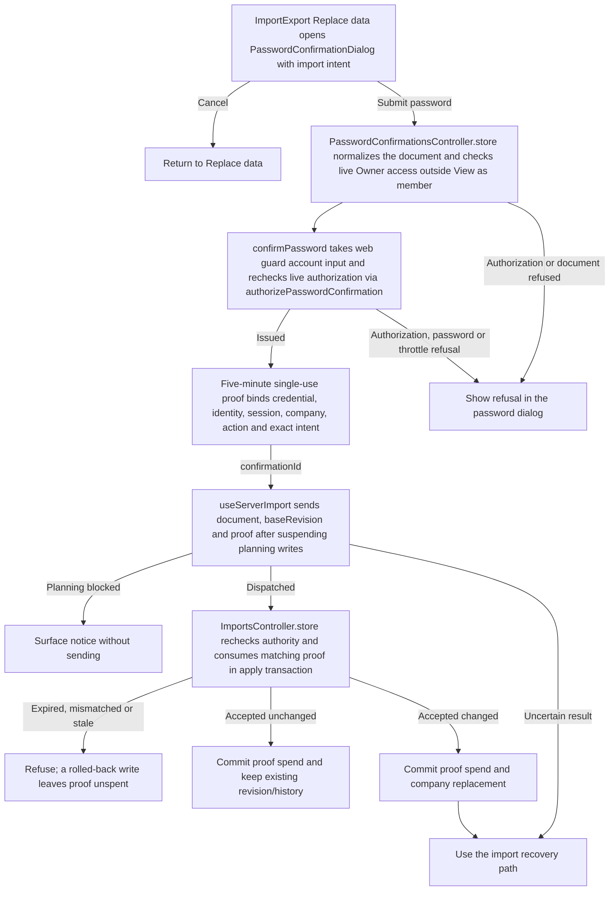

# US-DAT-08 — Confirm the exact import operation

As an Owner, I want to confirm the exact import operation so that my password cannot authorise a different replacement.

**Status:** Current
**Access:** Owner
**Entry:** Import preview → Replace data → password confirmation
**Documentation:** [Settings](../../docs-src/using/settings.md#import-and-export)
**Source:** [ImportExport.tsx](../../apps/frontend/src/components/ImportExport.tsx)

## Acceptance criteria

- Use the **Password** field in [Import company data](US-DAT-02-import-json.md). **Continue** confirms this previewed import; **Cancel** leaves the data unchanged.

## User flow

## Code flow

See [Preview and replace company data](US-DAT-02-import-json.md#code-flow) for reconciliation after dispatch.

**Code references:** [ImportExport.tsx](../../apps/frontend/src/components/ImportExport.tsx#L233) · [PasswordConfirmationDialog.tsx](../../apps/frontend/src/auth/PasswordConfirmationDialog.tsx#L1) · [password_confirmation_service.ts](../../apps/backend/app/services/auth/password_confirmation_service.ts#L49) · [package_callbacks_provider.ts](../../apps/backend/providers/package_callbacks_provider.ts#L62) · [password_confirmations_controller.ts](../../apps/backend/app/controllers/password_confirmations_controller.ts#L33) · [imports_controller.ts](../../apps/backend/app/controllers/imports_controller.ts#L30) · [company_import_service.ts](../../apps/backend/app/services/company_import_service.ts#L145) · [import_apply.spec.ts](../../apps/backend/tests/functional/import_apply.spec.ts#L344) · [import_apply.spec.ts](../../apps/backend/tests/functional/import_apply.spec.ts#L492) · [import_apply.spec.ts](../../apps/backend/tests/functional/import_apply.spec.ts#L668)
