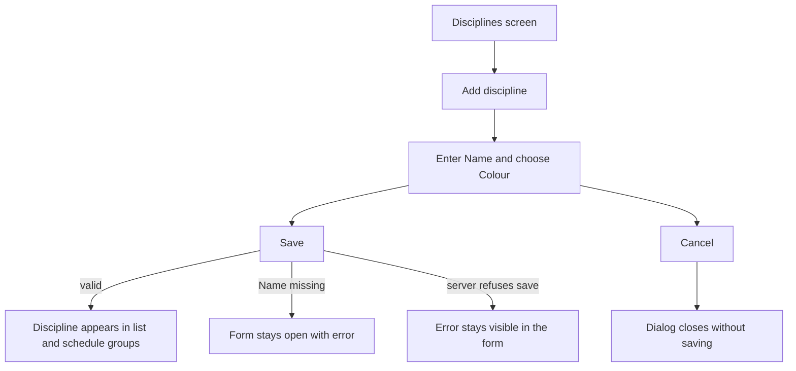
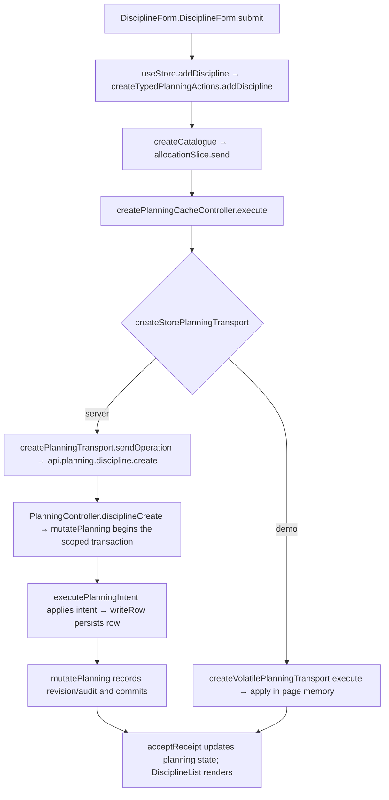

# US-DIS-01 — Add a discipline

As an Editor, I want to add a named, coloured discipline so that resources can be grouped on the schedule.

**Status:** Current
**Access:** Editor and above (Editor, Admin, Owner)
**Entry:** Disciplines screen → Add discipline
**Documentation:** [Guide](../../docs-src/using/disciplines.md)
**Source:** [DisciplineList.tsx](../../apps/frontend/src/components/disciplines/DisciplineList.tsx) · [DisciplineForm.tsx](../../apps/frontend/src/components/disciplines/DisciplineForm.tsx)

## Acceptance criteria

| Field  | Control         | Required/default/conditions           |
| ------ | --------------- | ------------------------------------- |
| Name   | Text field      | Required; initially blank             |
| Colour | Preset swatches | Defaults to discipline colour #2d75da |

- **Save** adds the discipline; its sort order is assigned automatically after existing disciplines. **Cancel** closes without saving.

## User flow

## Code flow

**Code references:** [DisciplineForm.tsx](../../apps/frontend/src/components/disciplines/DisciplineForm.tsx) · [typedPlanningActions.ts](../../apps/frontend/src/store/typedPlanningActions.ts) · [allocationSlice.ts](../../apps/frontend/src/store/slices/allocationSlice.ts) · [planningCacheController.ts](../../apps/frontend/src/data/planning/planningCacheController.ts) · [storePlanningTransport.ts](../../apps/frontend/src/data/planning/storePlanningTransport.ts) · [planningTransport.ts](../../apps/frontend/src/data/planning/planningTransport.ts) · [volatilePlanningTransport.ts](../../apps/frontend/src/data/planning/volatilePlanningTransport.ts) · [planning_routes.ts](../../apps/backend/start/planning_routes.ts) · [planning_controller.ts](../../apps/backend/app/controllers/planning_controller.ts) · [planning.ts](../../apps/backend/app/services/planning.ts) · [execute.ts](../../apps/backend/app/services/planning/execute.ts) · [writer.ts](../../apps/backend/app/services/planning/writer.ts)
