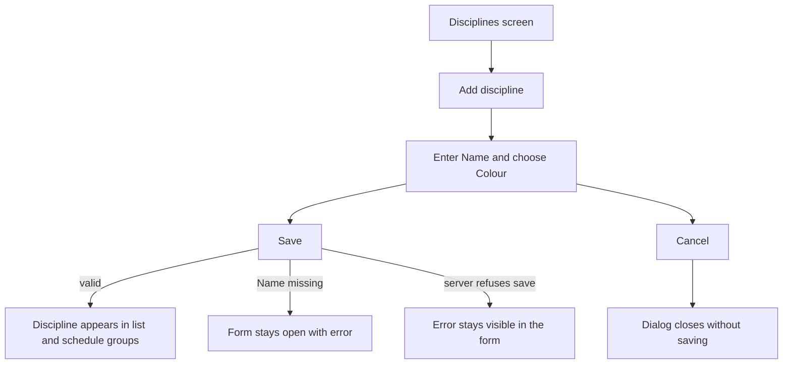
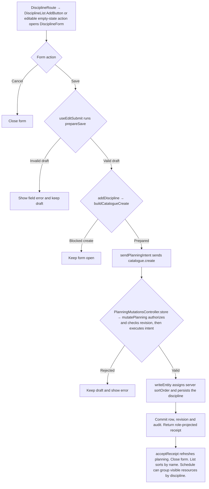

# US-DIS-01 — Add a discipline

As an Editor, I want to add a named, coloured discipline so that resources can be grouped on the schedule.

**Status:** Current
**Access:** Editor and above (Editor, Admin, Owner)
**Entry:** Disciplines screen → Add discipline
**Documentation:** [Guide](../../docs-src/using/disciplines.md)
**Source:** [DisciplineList.tsx](../../apps/frontend/src/components/disciplines/DisciplineList.tsx) · [DisciplineForm.tsx](../../apps/frontend/src/components/disciplines/DisciplineForm.tsx)

## Acceptance criteria

| Field  | Control         | Required/default/conditions           |
| ------ | --------------- | ------------------------------------- |
| Name   | Text field      | Required; initially blank             |
| Colour | Preset swatches | Defaults to discipline colour #2d75da |

- **Save** adds the discipline; its sort order is assigned automatically after existing disciplines. **Cancel** closes without saving.

## User flow

## Code flow

Owner, Admin and Editor can write planning data. Viewer and view-as-member lack write authority. The write goes through `POST /api/v1/companies/:companyId/planning/mutations` with admitted company access. The planning cache refreshes on a stale revision and reconciles an uncertain write before another attempt. Footer Cancel closes the form, including during a pending save. The dispatched save can still settle. The router exposes Disciplines only when Use disciplines is enabled. The server owns `sortOrder` on create. It assigns zero when the company query returns no disciplines, or one above the largest returned order. The query excludes soft-deleted disciplines.

**Code references:** [DisciplineList.tsx](../../apps/frontend/src/components/disciplines/DisciplineList.tsx#L23) · [DisciplineForm.tsx](../../apps/frontend/src/components/disciplines/DisciplineForm.tsx#L44) · [router.tsx](../../apps/frontend/src/router.tsx#L115) · [entity_write_service.ts](../../apps/backend/app/services/planning/entity_write_service.ts#L44) · [planning_service.ts](../../apps/backend/app/services/planning_service.ts#L270) · [state_repository_service.ts](../../apps/backend/app/services/state_repository_service.ts#L27) · [discipline.ts](../../apps/backend/app/models/discipline.ts#L9) · [operations.spec.ts](../../apps/backend/tests/functional/planning/operations.spec.ts#L142) · [Write controls](../../apps/frontend/src/components/common/crudButtons.tsx#L7) · [Cancel button](../../apps/frontend/src/components/common/FormButtons.tsx#L17) · [useEditSubmit.ts](../../apps/frontend/src/hooks/useEditSubmit.ts#L44) · [Row checks](../../apps/backend/app/services/planning/entity_write_service.ts#L91) · [typedPlanningActions.ts](../../apps/frontend/src/store/typedPlanningActions.ts#L179) · [planningIntents.ts](../../apps/frontend/src/data/planning/planningIntents.ts#L426) · [sendPlanningIntent](../../apps/frontend/src/store/slices/planningSessionSlice.ts#L139) · [Planning transport](../../apps/frontend/src/data/planning/planningTransport.ts#L64) · [Planning route](../../apps/backend/start/routes/planning.ts#L16) · [Mutation controller](../../apps/backend/app/controllers/planning_mutations_controller.ts#L19) · [Planning transaction](../../apps/backend/app/services/planning_service.ts#L222) · [Company write authority](../../apps/backend/app/services/planning/planning_access_service.ts#L31) · [Receipt and refresh](../../apps/frontend/src/data/planning/planningCache.ts#L469)
