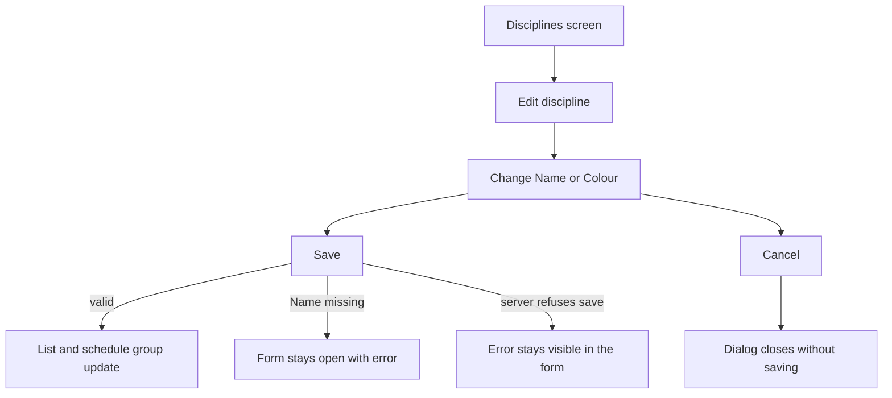
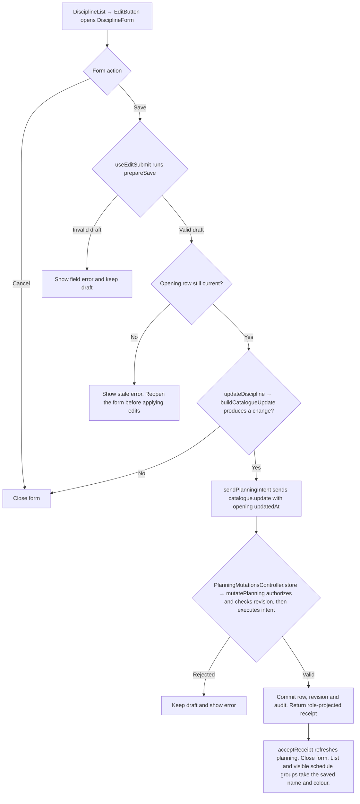

# US-DIS-02 — Edit a discipline

As an Editor, I want to edit a discipline name or colour so that schedule group labels stay current.

**Status:** Current
**Access:** Editor and above (Editor, Admin, Owner)
**Entry:** Disciplines screen → discipline row → Edit
**Documentation:** [Guide](../../docs-src/using/disciplines.md)
**Source:** [DisciplineList.tsx](../../apps/frontend/src/components/disciplines/DisciplineList.tsx) · [DisciplineForm.tsx](../../apps/frontend/src/components/disciplines/DisciplineForm.tsx)

## Acceptance criteria

| Field  | Control         | Required/default/conditions       |
| ------ | --------------- | --------------------------------- |
| Name   | Text field      | Required; current value prefilled |
| Colour | Preset swatches | Current colour preselected        |

- **Save** updates the discipline and preserves its sort order. **Cancel** closes without saving.

## User flow

## Code flow

Owner, Admin and Editor can write planning data. Viewer and view-as-member lack write authority. The write goes through `POST /api/companies/:companyId/planning/mutations` with admitted company access. The planning cache refreshes on a stale revision and reconciles an uncertain write before another attempt. Footer Cancel closes the form, including during a pending save. The dispatched save can still settle. Use disciplines gates this page. `DisciplineForm` submits name and colour, preserving the stored order. A missing colour in the opening row is prefilled with the discipline default.

**Code references:** [DisciplineList.tsx](../../apps/frontend/src/components/disciplines/DisciplineList.tsx#L23) · [DisciplineForm.tsx](../../apps/frontend/src/components/disciplines/DisciplineForm.tsx#L44) · [router.tsx](../../apps/frontend/src/router.tsx#L115) · [DisciplineForm.tsx](../../apps/frontend/src/components/disciplines/DisciplineForm.tsx#L32) · [selectors.ts](../../apps/frontend/src/store/selectors.ts#L129) · [Write controls](../../apps/frontend/src/components/common/crudButtons.tsx#L7) · [Cancel button](../../apps/frontend/src/components/common/FormButtons.tsx#L17) · [useEditSubmit.ts](../../apps/frontend/src/hooks/useEditSubmit.ts#L44) · [Row checks](../../apps/backend/app/services/planning/entity_write.ts#L97) · [typedPlanningActions.ts](../../apps/frontend/src/store/typedPlanningActions.ts#L181) · [planningIntents.ts](../../apps/frontend/src/data/planning/planningIntents.ts#L502) · [sendPlanningIntent](../../apps/frontend/src/store/slices/planningSessionSlice.ts#L139) · [Planning transport](../../apps/frontend/src/data/planning/planningTransport.ts#L64) · [Planning route](../../apps/backend/start/planning_routes.ts#L16) · [Mutation controller](../../apps/backend/app/controllers/planning_mutations_controller.ts#L9) · [Planning transaction](../../apps/backend/app/services/planning.ts#L198) · [Company write authority](../../apps/backend/app/services/planning/access.ts#L16) · [Receipt and refresh](../../apps/frontend/src/data/planning/planningCache.ts#L469)
