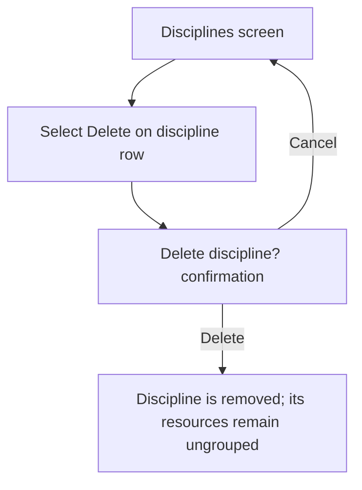
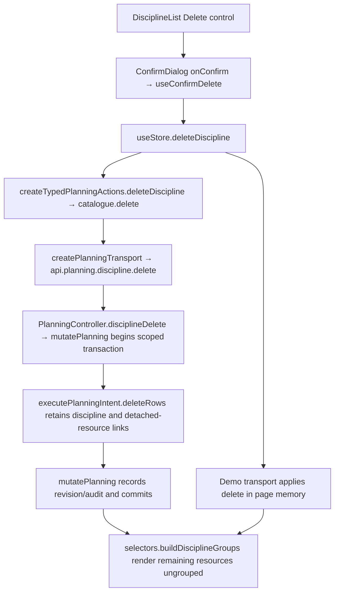

# US-DIS-03 — Delete a discipline (resources ungrouped, not deleted)

As an Editor, I want to remove a discipline so that its resources become ungrouped without being deleted.

**Status:** Current
**Access:** Editor and above (Editor, Admin, Owner)
**Entry:** Disciplines screen → discipline row → Delete {discipline name}
**Documentation:** [Guide](../../docs-src/using/disciplines.md)
**Source:** [DisciplineList.tsx](../../apps/frontend/src/components/disciplines/DisciplineList.tsx) · [ConfirmDialog.tsx](../../apps/frontend/src/components/common/dialogs.tsx)

## Acceptance criteria

- Selecting **Delete {discipline}** opens **Delete discipline?** with **Delete** and **Cancel** controls and states resources will be ungrouped, not deleted.
- **Cancel** leaves the discipline intact. **Delete** removes the discipline and clears its resource grouping; the resources remain.
- Undo restores the discipline and its resource group assignments.

## User flow

## Code flow

**Code references:** [DisciplineList.tsx](../../apps/frontend/src/components/disciplines/DisciplineList.tsx) · [useConfirmDelete.ts](../../apps/frontend/src/hooks/useConfirmDelete.ts) · [typedPlanningActions.ts](../../apps/frontend/src/store/typedPlanningActions.ts) · [planningTransport.ts](../../apps/frontend/src/data/planning/planningTransport.ts) · [volatilePlanningTransport.ts](../../apps/frontend/src/data/planning/volatilePlanningTransport.ts) · [selectors.ts](../../apps/frontend/src/store/selectors.ts) · [planning_routes.ts](../../apps/backend/start/planning_routes.ts) · [planning_controller.ts](../../apps/backend/app/controllers/planning_controller.ts) · [planning.ts](../../apps/backend/app/services/planning.ts) · [execute.ts](../../apps/backend/app/services/planning/execute.ts)
