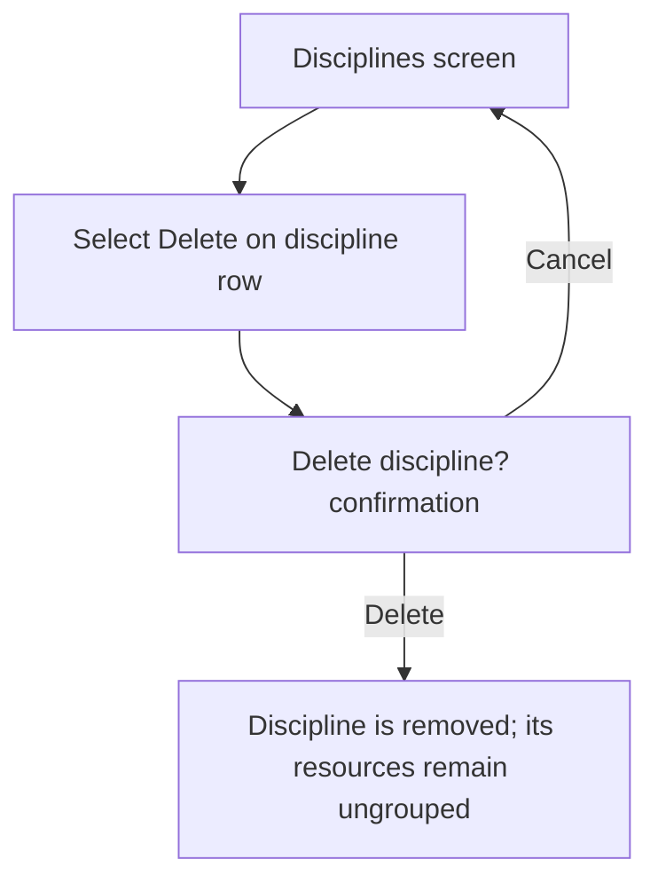
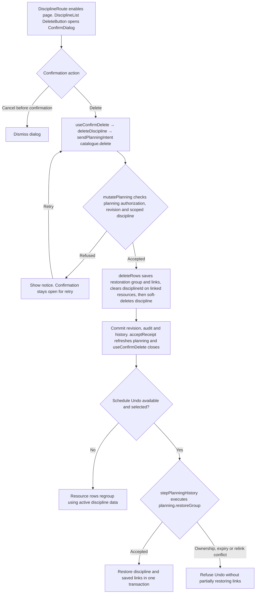

# US-DIS-03 — Delete a discipline (resources ungrouped, not deleted)

As an Editor, I want to remove a discipline so that its resources become ungrouped without being deleted.

**Status:** Current
**Access:** Editor and above (Editor, Admin, Owner)
**Entry:** Disciplines screen → discipline row → Delete {discipline name}
**Documentation:** [Guide](../../docs-src/using/disciplines.md)
**Source:** [DisciplineList.tsx](../../apps/frontend/src/components/disciplines/DisciplineList.tsx) · [ConfirmDialog.tsx](../../apps/frontend/src/components/common/dialogs.tsx)

## Acceptance criteria

- Selecting **Delete {discipline}** opens **Delete discipline?** with **Delete** and **Cancel** controls and states resources will be ungrouped, not deleted.
- **Cancel** leaves the discipline intact. **Delete** removes the discipline and clears its resource grouping; the resources remain.
- Undo restores the discipline and its resource group assignments.

## User flow

## Code flow

Owner, Admin and Editor can write planning data. Viewer and view-as-member lack write authority. The route uses Use disciplines. After a failure the mounted `ConfirmDialog` has its confirmation ref set, so Cancel and Escape cannot dismiss that prompt. Undo requires the originating usable history and restoration group. A missing locally owned discipline can short-circuit deletion and close the confirmation.

**Code references:** [DisciplineList.tsx](../../apps/frontend/src/components/disciplines/DisciplineList.tsx#L23) · [DisciplineForm.tsx](../../apps/frontend/src/components/disciplines/DisciplineForm.tsx#L44) · [router.tsx](../../apps/frontend/src/router.tsx#L115) · [useConfirmDelete.ts](../../apps/frontend/src/hooks/useConfirmDelete.ts#L5) · [dialogs.tsx](../../apps/frontend/src/components/common/dialogs.tsx#L219) · [typedPlanningActions.ts](../../apps/frontend/src/store/typedPlanningActions.ts#L183) · [restoration.ts](../../apps/backend/app/services/planning/restoration.ts#L52) · [restoration.ts](../../apps/backend/app/services/planning/restoration.ts#L159) · [planning.ts](../../apps/backend/app/services/planning.ts#L154) · [restoration_catalogue.spec.ts](../../apps/backend/tests/functional/planning/restoration_catalogue.spec.ts#L84) · [sendPlanningIntent](../../apps/frontend/src/store/slices/planningSessionSlice.ts#L139) · [Planning transport](../../apps/frontend/src/data/planning/planningTransport.ts#L64) · [Planning route](../../apps/backend/start/planning_routes.ts#L16) · [Mutation controller](../../apps/backend/app/controllers/planning_mutations_controller.ts#L9) · [Planning transaction](../../apps/backend/app/services/planning.ts#L198) · [Company write authority](../../apps/backend/app/services/planning/access.ts#L16) · [Receipt and refresh](../../apps/frontend/src/data/planning/planningCache.ts#L469)
