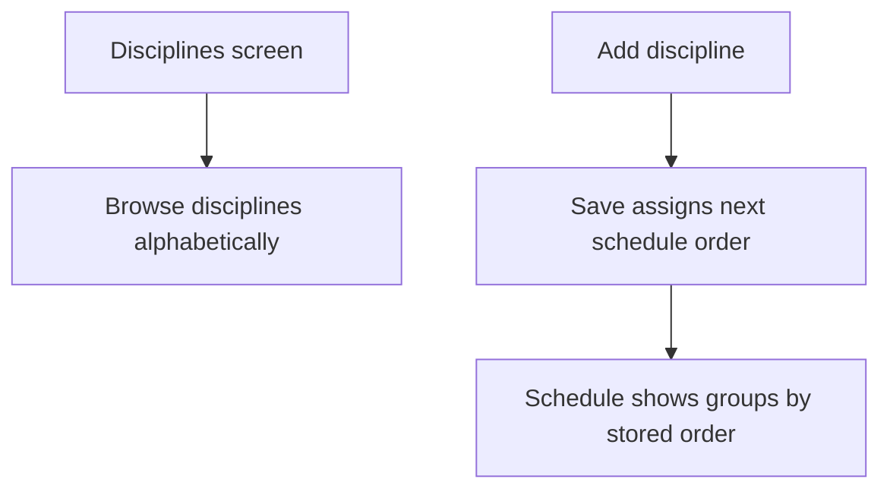
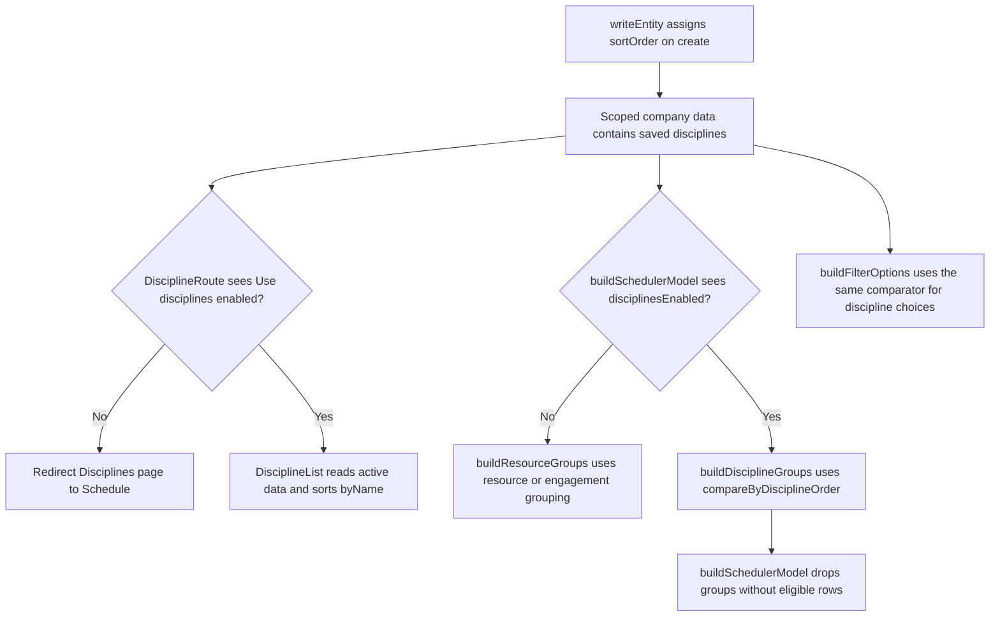

# US-DIS-04 — Disciplines use a predictable order on each surface

As an Editor, I want disciplines ordered for easy browsing so that the schedule keeps a predictable group order.

**Status:** Current
**Access:** Viewer, Editor, Admin or Owner
**Entry:** Disciplines screen → list; Schedule → discipline groups
**Documentation:** [Guide](../../docs-src/using/disciplines.md)
**Source:** [DisciplineList.tsx](../../apps/frontend/src/components/disciplines/DisciplineList.tsx) · [selectors.ts](../../apps/frontend/src/store/selectors.ts)

## Acceptance criteria

- The Disciplines management list is alphabetically ordered.
- Add discipline has no Sort order field; a new discipline receives the next schedule order. The Schedule groups follow stored order.

## User flow

## Code flow

The read surfaces are available to company readers under their settings gates. DisciplineList write controls require edit authority. Schedule ordering uses stored `sortOrder`, then name and id. The filter picker can include a discipline with zero visible scheduled rows when the picker is available.

**Code references:** [DisciplineList.tsx](../../apps/frontend/src/components/disciplines/DisciplineList.tsx#L23) · [DisciplineForm.tsx](../../apps/frontend/src/components/disciplines/DisciplineForm.tsx#L44) · [router.tsx](../../apps/frontend/src/router.tsx#L115) · [displayOrder.ts](../../apps/frontend/src/lib/displayOrder.ts#L116) · [selectors.ts](../../apps/frontend/src/store/selectors.ts#L129) · [selectors.ts](../../apps/frontend/src/store/selectors.ts#L147) · [schedulerModel.ts](../../apps/frontend/src/components/scheduler/schedulerModel.ts#L208) · [toolbarFilterOptions.ts](../../apps/frontend/src/components/scheduler/toolbarFilterOptions.ts#L16) · [entity_write_service.ts](../../apps/backend/app/services/planning/entity_write_service.ts#L44)
