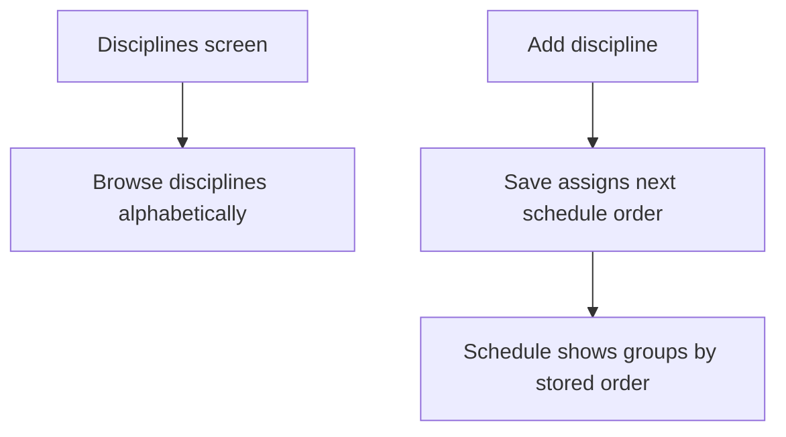
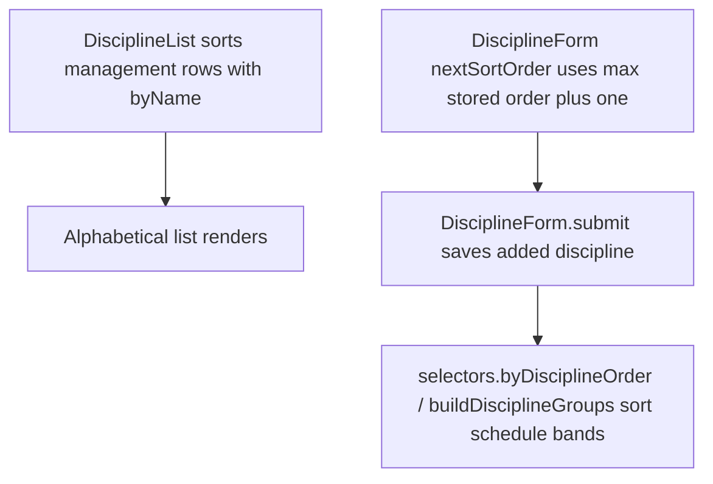

# US-DIS-04 — Disciplines use a predictable order on each surface

As an Editor, I want disciplines ordered for easy browsing so that the schedule keeps a predictable group order.

**Status:** Current
**Access:** Viewer, Editor, Admin or Owner
**Entry:** Disciplines screen → list; Schedule → discipline groups
**Documentation:** [Guide](../../docs-src/using/disciplines.md)
**Source:** [DisciplineList.tsx](../../apps/frontend/src/components/disciplines/DisciplineList.tsx) · [selectors.ts](../../apps/frontend/src/store/selectors.ts)

## Acceptance criteria

- The Disciplines management list is alphabetically ordered.
- Add discipline has no Sort order field; a new discipline receives the next schedule order. The Schedule groups follow stored order.

## User flow

## Code flow

**Code references:** [DisciplineList.tsx](../../apps/frontend/src/components/disciplines/DisciplineList.tsx) · [DisciplineForm.tsx](../../apps/frontend/src/components/disciplines/DisciplineForm.tsx) · [selectors.ts](../../apps/frontend/src/store/selectors.ts)
