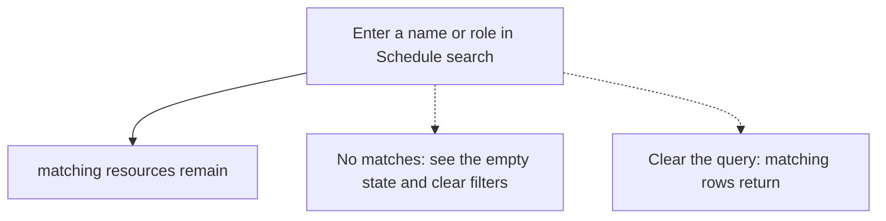
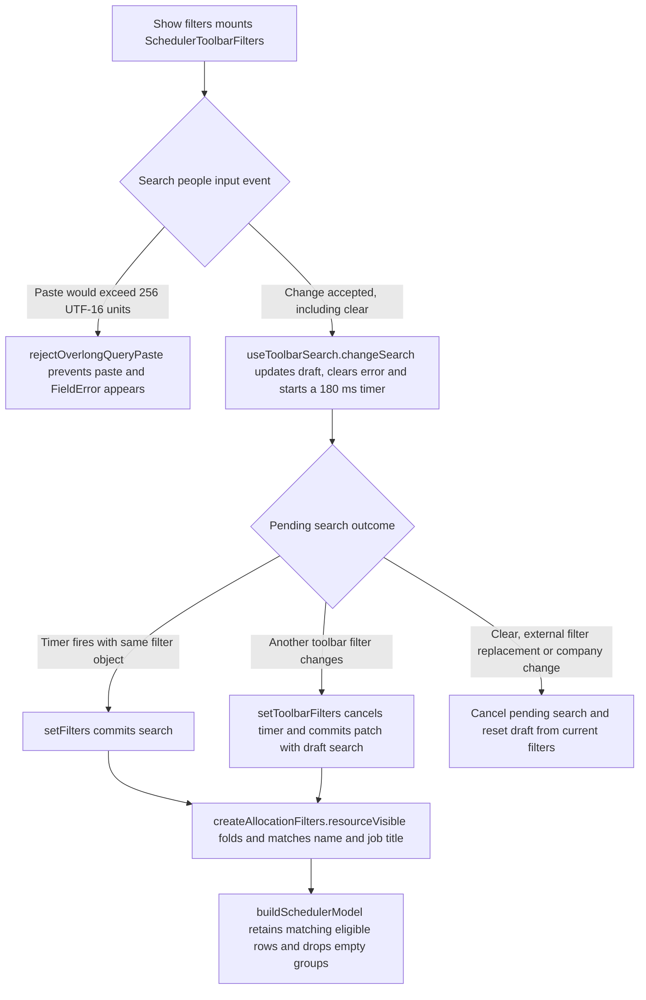

# US-FIL-01 — Search resources by name or role

As a company member, I want to search resources by name or role so that I can find the people I want to review.

**Status:** Current

**Access:** Viewer, Editor, Admin or Owner

**Entry:** Schedule (`/`)

**Documentation:** [schedule-work.md](../../docs-src/using/schedule-work.md)

**Source:** [SchedulerToolbarSections.tsx](../../apps/frontend/src/components/scheduler/SchedulerToolbarSections.tsx)

## Acceptance criteria

- **Search people…** filters resource rows by resource name or role.
- Clearing the query restores the matching rows.

## User flow

## Code flow

These controls use in-memory schedule filters for any role that can open Schedule, including Viewer and view-as-member. Clearing only the input keeps the other filter choices. The predicate folds the trimmed term and a combined string containing the display name, stored name and job title.

**Code references:** [SchedulerToolbarSections.tsx](../../apps/frontend/src/components/scheduler/SchedulerToolbarSections.tsx#L221) · [localQueryInput.ts](../../apps/frontend/src/lib/localQueryInput.ts#L5) · [useToolbarSearch.ts](../../apps/frontend/src/components/scheduler/useToolbarSearch.ts#L22) · [schedulerModelFilters.ts](../../apps/frontend/src/components/scheduler/schedulerModelFilters.ts#L26) · [schedulerModel.ts](../../apps/frontend/src/components/scheduler/schedulerModel.ts#L208) · [SchedulerToolbar.test.tsx](../../apps/frontend/src/components/scheduler/SchedulerToolbar.test.tsx#L552)
