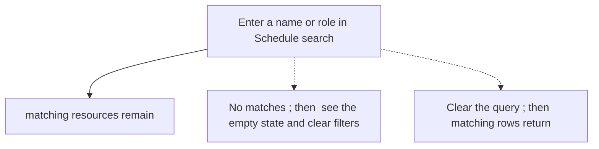
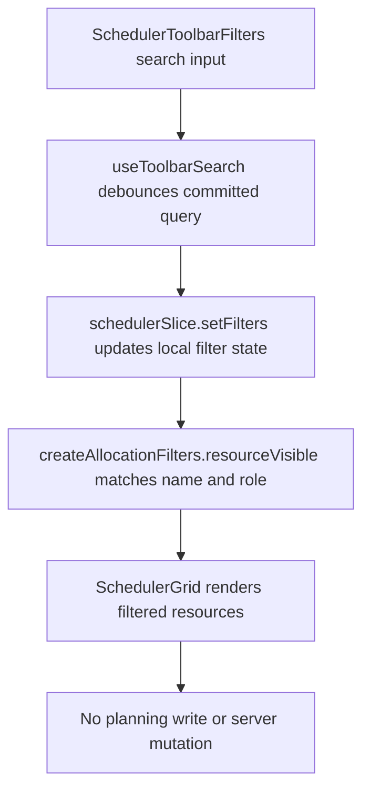

# US-FIL-01 — Search resources by name or role

As a company member, I want to search resources by name or role so that I can find the people I want to review.

**Status:** Current

**Access:** Viewer, Editor, Admin or Owner

**Entry:** Schedule (`/`)

**Documentation:** [schedule-work.md](../../docs-src/using/schedule-work.md)

**Source:** [SchedulerToolbarSections.tsx](../../apps/frontend/src/components/scheduler/SchedulerToolbarSections.tsx)

## Acceptance criteria

- **Search people…** filters resource rows by resource name or role.
- Clearing the query restores the matching rows.

## User flow

## Code flow

**Code references:**

- [schedulerSlice.ts](../../apps/frontend/src/store/slices/schedulerSlice.ts)
- [SchedulerToolbarSections.tsx](../../apps/frontend/src/components/scheduler/SchedulerToolbarSections.tsx)
- [useToolbarSearch.ts](../../apps/frontend/src/components/scheduler/useToolbarSearch.ts)
- [SchedulerToolbar.tsx](../../apps/frontend/src/components/scheduler/SchedulerToolbar.tsx)
- [schedulerModelFilters.ts](../../apps/frontend/src/components/scheduler/schedulerModelFilters.ts)
- [schedulerModel.ts](../../apps/frontend/src/components/scheduler/schedulerModel.ts)
- [SchedulerGrid.tsx](../../apps/frontend/src/components/scheduler/SchedulerGrid.tsx)
