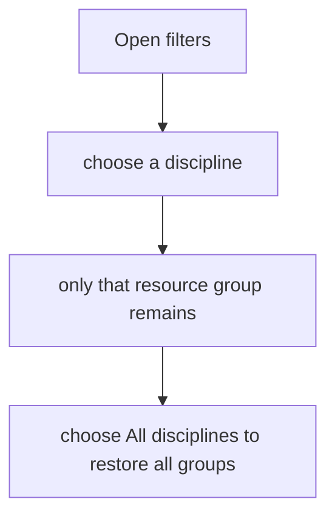
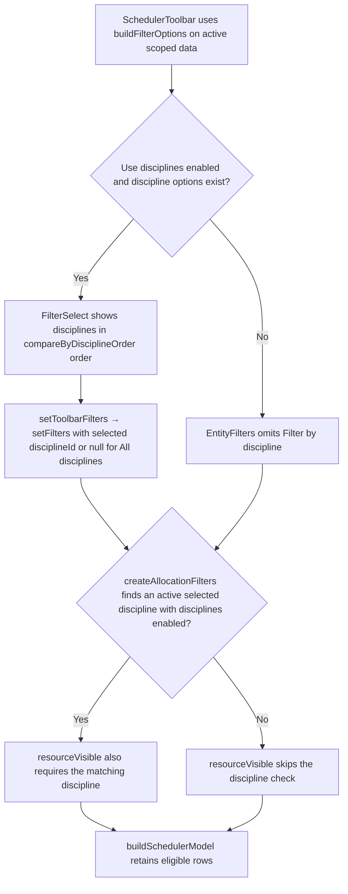

# US-FIL-02 — Filter by discipline

As a company member, I want to filter resources by discipline so that I can focus on one team.

**Status:** Current

**Access:** Viewer, Editor, Admin or Owner

**Entry:** Schedule (`/`)

**Documentation:** [schedule-work.md](../../docs-src/using/schedule-work.md)

**Source:** [SchedulerToolbarSections.tsx](../../apps/frontend/src/components/scheduler/SchedulerToolbarSections.tsx)

## Acceptance criteria

- **Filter by discipline** appears only when disciplines are enabled and at least one exists; it lists the disciplines in schedule order after **All disciplines**.
- Selecting a discipline shows only the resources in that discipline; **All disciplines** restores every group.

## User flow

## Code flow

These controls use in-memory schedule filters for any role that can open Schedule, including Viewer and view-as-member. A deleted discipline id can remain in the filter store while the model skips it. The toolbar commits the current draft search with the selection.

**Code references:** [toolbarFilterOptions.ts](../../apps/frontend/src/components/scheduler/toolbarFilterOptions.ts#L16) · [SchedulerToolbarSections.tsx](../../apps/frontend/src/components/scheduler/SchedulerToolbarSections.tsx#L111) · [useToolbarSearch.ts](../../apps/frontend/src/components/scheduler/useToolbarSearch.ts#L47) · [schedulerSlice.ts](../../apps/frontend/src/store/slices/schedulerSlice.ts#L138) · [schedulerModelFilters.ts](../../apps/frontend/src/components/scheduler/schedulerModelFilters.ts#L81) · [schedulerModel.ts](../../apps/frontend/src/components/scheduler/schedulerModel.ts#L208) · [SchedulerToolbar.test.tsx](../../apps/frontend/src/components/scheduler/SchedulerToolbar.test.tsx#L151)
