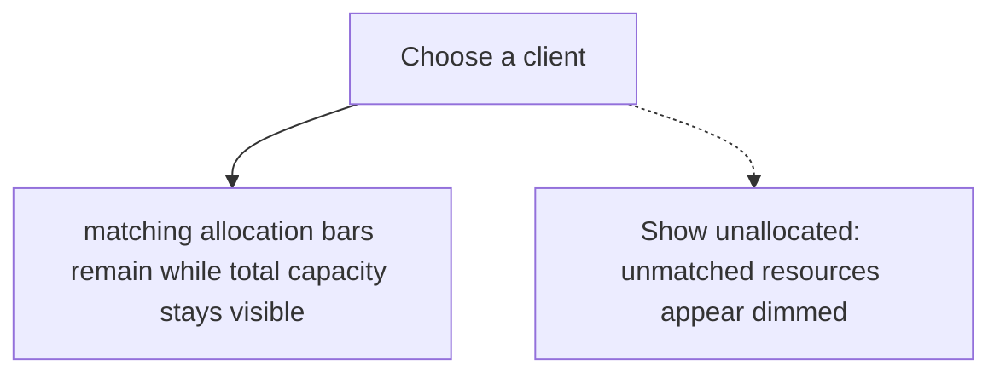
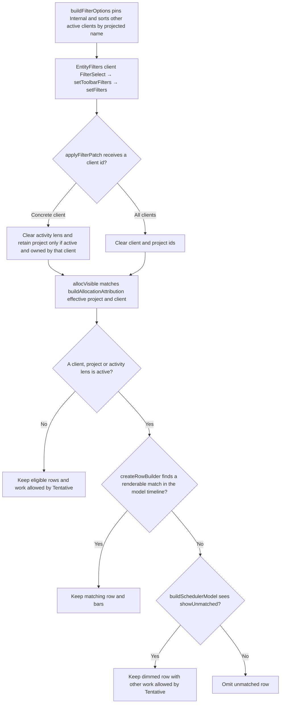

# US-FIL-03 — Filter by client

As a company member, I want to filter allocations by client while keeping capacity cues truthful so that I can review client work without hiding total workload.

**Status:** Current

**Access:** Viewer, Editor, Admin or Owner

**Entry:** Schedule (`/`)

**Documentation:** [schedule-work.md](../../docs-src/using/schedule-work.md)

**Source:** [SchedulerToolbarSections.tsx](../../apps/frontend/src/components/scheduler/SchedulerToolbarSections.tsx)

## Acceptance criteria

- **Filter by client** lists Internal first, then clients by name. Choosing one limits visible allocations to that client and hides resources without matching work; capacity figures still include all work.
- **Show unallocated** reveals the hidden resources as dimmed rows.

## User flow

## Code flow

These controls use in-memory schedule filters for any role that can open Schedule, including Viewer and view-as-member. `buildAllocationAttribution` uses the effective project’s client when the project resolves. Projectless work with a known activity uses the scoped Internal client when available. Server capacity is a separate input to row construction.

**Code references:** [toolbarFilterOptions.ts](../../apps/frontend/src/components/scheduler/toolbarFilterOptions.ts#L16) · [SchedulerToolbarSections.tsx](../../apps/frontend/src/components/scheduler/SchedulerToolbarSections.tsx#L111) · [useToolbarSearch.ts](../../apps/frontend/src/components/scheduler/useToolbarSearch.ts#L47) · [schedulerSlice.ts](../../apps/frontend/src/store/slices/schedulerSlice.ts#L80) · [buildAllocationAttribution.ts](../../apps/frontend/src/lib/buildAllocationAttribution.ts#L18) · [schedulerModelFilters.ts](../../apps/frontend/src/components/scheduler/schedulerModelFilters.ts#L31) · [schedulerRowModel.ts](../../apps/frontend/src/components/scheduler/schedulerRowModel.ts#L164) · [schedulerModel.ts](../../apps/frontend/src/components/scheduler/schedulerModel.ts#L208) · [SchedulerToolbar.test.tsx](../../apps/frontend/src/components/scheduler/SchedulerToolbar.test.tsx#L307)
