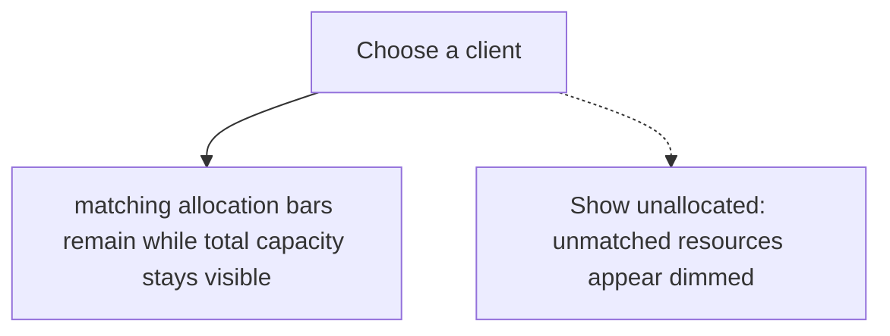
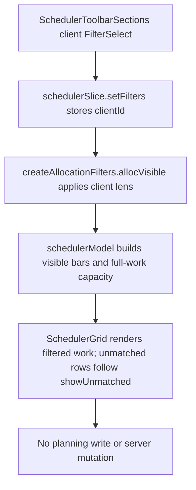

# US-FIL-03 — Filter by client

As a company member, I want to filter allocations by client while keeping capacity cues truthful so that I can review client work without hiding total workload.

**Status:** Current

**Access:** Viewer, Editor, Admin or Owner

**Entry:** Schedule (`/`)

**Documentation:** [schedule-work.md](../../docs-src/using/schedule-work.md)

**Source:** [SchedulerToolbarSections.tsx](../../apps/frontend/src/components/scheduler/SchedulerToolbarSections.tsx)

## Acceptance criteria

- **Filter by client** lists Internal first, then clients by name. Choosing one limits visible allocations to that client and hides resources without matching work; capacity figures still include all work.
- **Show unallocated** reveals the hidden resources as dimmed rows.

## User flow

## Code flow

**Code references:**

- [schedulerSlice.ts](../../apps/frontend/src/store/slices/schedulerSlice.ts)
- [SchedulerToolbarSections.tsx](../../apps/frontend/src/components/scheduler/SchedulerToolbarSections.tsx)
- [SchedulerToolbar.tsx](../../apps/frontend/src/components/scheduler/SchedulerToolbar.tsx)
- [schedulerModelFilters.ts](../../apps/frontend/src/components/scheduler/schedulerModelFilters.ts)
- [schedulerModel.ts](../../apps/frontend/src/components/scheduler/schedulerModel.ts)
- [SchedulerGrid.tsx](../../apps/frontend/src/components/scheduler/SchedulerGrid.tsx)
