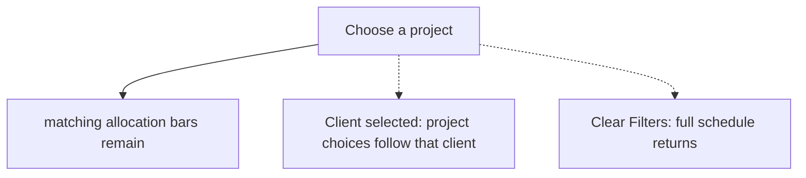
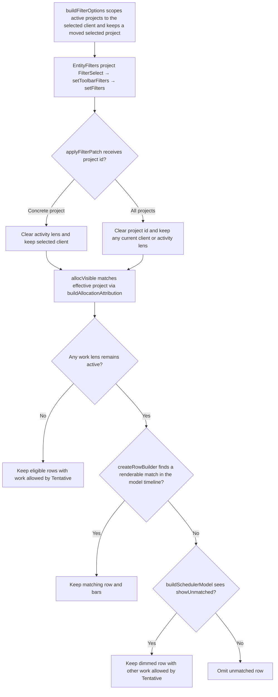

# US-FIL-04 — Filter by project

As a company member, I want to filter allocations by project so that I can focus on work for that project.

**Status:** Current

**Access:** Viewer, Editor, Admin or Owner

**Entry:** Schedule (`/`)

**Documentation:** [schedule-work.md](../../docs-src/using/schedule-work.md)

**Source:** [SchedulerToolbarSections.tsx](../../apps/frontend/src/components/scheduler/SchedulerToolbarSections.tsx)

## Acceptance criteria

- **Filter by project** limits visible allocations to the selected project; resources with no matching work are hidden unless **Show unallocated** is checked.
- With a client selected, the choices are that client’s projects (a project already selected stays listed). Choosing a different client clears a project that does not belong to it; **Clear Filters** restores the full schedule.

## User flow

## Code flow

These controls use in-memory schedule filters for any role that can open Schedule, including Viewer and view-as-member. Effective project attribution includes All projects work assigned to that project. If the moved project remains selected alongside the old client, the predicates still require both ids. Changing the client clears an incompatible project and choosing All clients clears any project. Labels use role-projected names, with ordering based on server `displayName` when present.

**Code references:** [toolbarFilterOptions.ts](../../apps/frontend/src/components/scheduler/toolbarFilterOptions.ts#L16) · [SchedulerToolbarSections.tsx](../../apps/frontend/src/components/scheduler/SchedulerToolbarSections.tsx#L111) · [useToolbarSearch.ts](../../apps/frontend/src/components/scheduler/useToolbarSearch.ts#L47) · [schedulerSlice.ts](../../apps/frontend/src/store/slices/schedulerSlice.ts#L80) · [buildAllocationAttribution.ts](../../apps/frontend/src/lib/buildAllocationAttribution.ts#L18) · [schedulerModelFilters.ts](../../apps/frontend/src/components/scheduler/schedulerModelFilters.ts#L31) · [schedulerRowModel.ts](../../apps/frontend/src/components/scheduler/schedulerRowModel.ts#L164) · [schedulerModel.ts](../../apps/frontend/src/components/scheduler/schedulerModel.ts#L208) · [SchedulerToolbar.test.tsx](../../apps/frontend/src/components/scheduler/SchedulerToolbar.test.tsx#L339)
