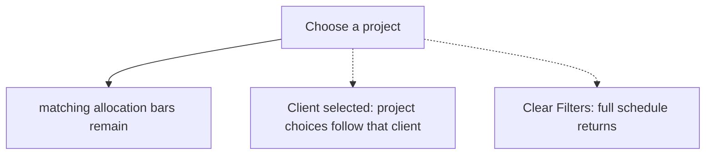
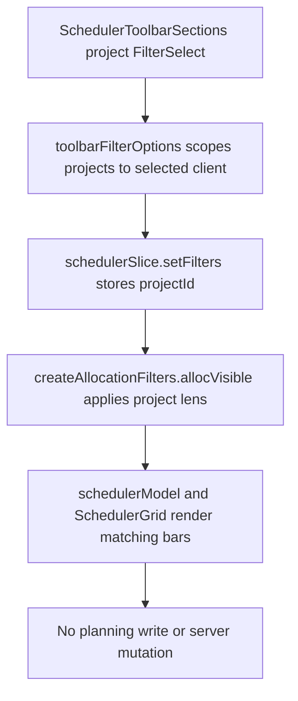

# US-FIL-04 — Filter by project

As a company member, I want to filter allocations by project so that I can focus on work for that project.

**Status:** Current

**Access:** Viewer, Editor, Admin or Owner

**Entry:** Schedule (`/`)

**Documentation:** [schedule-work.md](../../docs-src/using/schedule-work.md)

**Source:** [SchedulerToolbarSections.tsx](../../apps/frontend/src/components/scheduler/SchedulerToolbarSections.tsx)

## Acceptance criteria

- **Filter by project** limits visible allocations to the selected project; resources with no matching work are hidden unless **Show unallocated** is checked.
- With a client selected, the choices are that client’s projects (a project already selected stays listed). Choosing a different client clears a project that does not belong to it; **Clear Filters** restores the full schedule.

## User flow

## Code flow

**Code references:**

- [schedulerSlice.ts](../../apps/frontend/src/store/slices/schedulerSlice.ts)
- [SchedulerToolbarSections.tsx](../../apps/frontend/src/components/scheduler/SchedulerToolbarSections.tsx)
- [SchedulerToolbar.tsx](../../apps/frontend/src/components/scheduler/SchedulerToolbar.tsx)
- [schedulerModelFilters.ts](../../apps/frontend/src/components/scheduler/schedulerModelFilters.ts)
- [schedulerModel.ts](../../apps/frontend/src/components/scheduler/schedulerModel.ts)
- [SchedulerGrid.tsx](../../apps/frontend/src/components/scheduler/SchedulerGrid.tsx)
