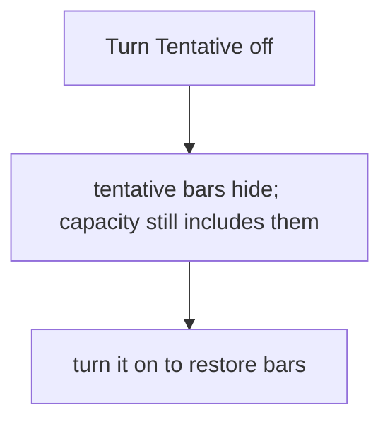
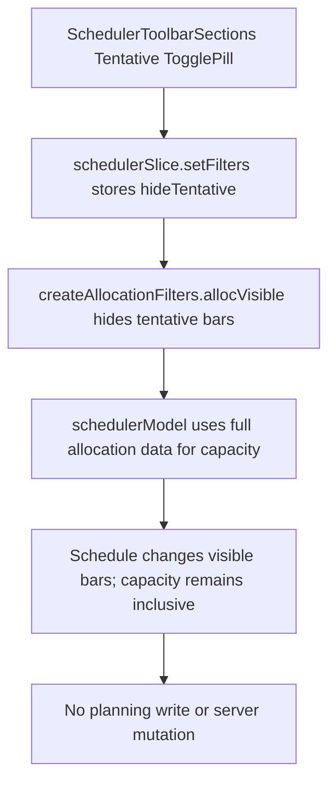

# US-FIL-05 — Hide tentative allocations

As a company member, I want to hide tentative allocations so that I can present a confirmed plan while capacity still counts tentative work.

**Status:** Current

**Access:** Viewer, Editor, Admin or Owner

**Entry:** Schedule (`/`)

**Documentation:** [schedule-work.md](../../docs-src/using/schedule-work.md)

**Source:** [SchedulerToolbarSections.tsx](../../apps/frontend/src/components/scheduler/SchedulerToolbarSections.tsx)

## Acceptance criteria

- Turning **Tentative** off hides tentative bars; turning it on restores them.
- Capacity indicators continue to include hidden tentative allocations.

## User flow

## Code flow

**Code references:**

- [schedulerSlice.ts](../../apps/frontend/src/store/slices/schedulerSlice.ts)
- [SchedulerToolbarSections.tsx](../../apps/frontend/src/components/scheduler/SchedulerToolbarSections.tsx)
- [SchedulerToolbar.tsx](../../apps/frontend/src/components/scheduler/SchedulerToolbar.tsx)
- [schedulerModelFilters.ts](../../apps/frontend/src/components/scheduler/schedulerModelFilters.ts)
- [schedulerModel.ts](../../apps/frontend/src/components/scheduler/schedulerModel.ts)
- [SchedulerGrid.tsx](../../apps/frontend/src/components/scheduler/SchedulerGrid.tsx)
