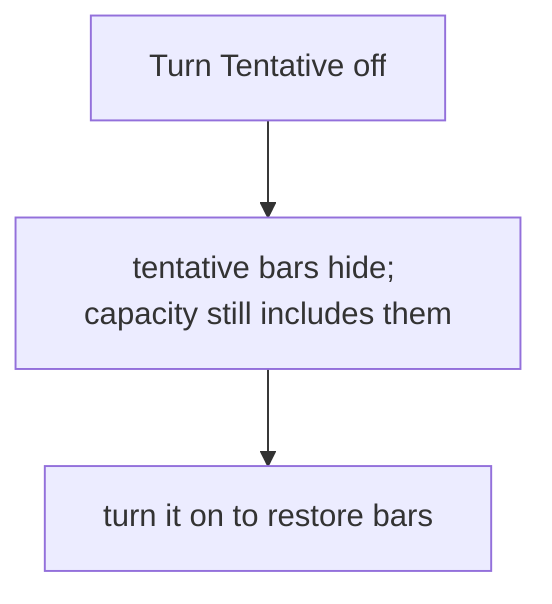
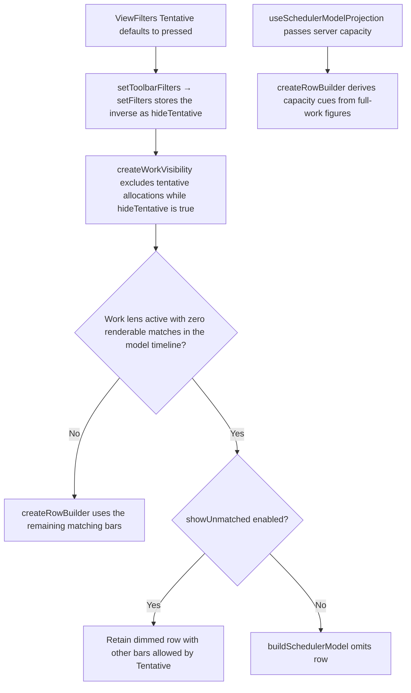

# US-FIL-05 — Hide tentative allocations

As a company member, I want to hide tentative allocations so that I can present a confirmed plan while capacity still counts tentative work.

**Status:** Current

**Access:** Viewer, Editor, Admin or Owner

**Entry:** Schedule (`/`)

**Documentation:** [schedule-work.md](../../docs-src/using/schedule-work.md)

**Source:** [SchedulerToolbarSections.tsx](../../apps/frontend/src/components/scheduler/SchedulerToolbarSections.tsx)

## Acceptance criteria

- Turning **Tentative** off hides tentative bars; turning it on restores them.
- Capacity indicators continue to include hidden tentative allocations.

## User flow

## Code flow

These controls use in-memory schedule filters for any role that can open Schedule, including Viewer and view-as-member. Pressing Tentative again restores bars eligible under the other filters. The toolbar commits any draft search with the toggle.

**Code references:** [SchedulerToolbarSections.tsx](../../apps/frontend/src/components/scheduler/SchedulerToolbarSections.tsx#L152) · [useToolbarSearch.ts](../../apps/frontend/src/components/scheduler/useToolbarSearch.ts#L47) · [schedulerSlice.ts](../../apps/frontend/src/store/slices/schedulerSlice.ts#L138) · [schedulerModelFilters.ts](../../apps/frontend/src/components/scheduler/schedulerModelFilters.ts#L31) · [schedulerRowModel.ts](../../apps/frontend/src/components/scheduler/schedulerRowModel.ts#L164) · [schedulerModel.ts](../../apps/frontend/src/components/scheduler/schedulerModel.ts#L208) · [useSchedulerGridModel.ts](../../apps/frontend/src/components/scheduler/useSchedulerGridModel.ts#L114) · [schedulerModel.filters.test.ts](../../apps/frontend/src/components/scheduler/schedulerModel.filters.test.ts#L86) · [schedulerModel.filters.test.ts](../../apps/frontend/src/components/scheduler/schedulerModel.filters.test.ts#L231)
