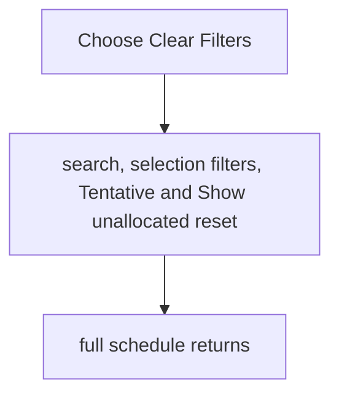
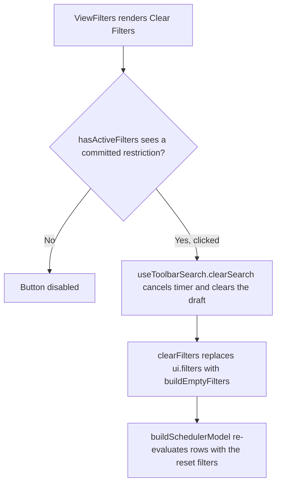

# US-FIL-06 — Clear all filters at once

As a company member, I want to clear all active filters at once so that I can return to the full schedule quickly.

**Status:** Current

**Access:** Viewer, Editor, Admin or Owner

**Entry:** Schedule (`/`)

**Documentation:** [schedule-work.md](../../docs-src/using/schedule-work.md)

**Source:** [SchedulerToolbarSections.tsx](../../apps/frontend/src/components/scheduler/SchedulerToolbarSections.tsx)

## Acceptance criteria

- **Clear Filters** is enabled only when search, a discipline, client, project or activity filter is set, or Tentative is turned off.
- Selecting it resets search, every selection filter, Tentative (back on) and Show unallocated (back off).

## User flow

## Code flow

These controls use in-memory schedule filters for any role that can open Schedule, including Viewer and view-as-member. `hasActiveFilters` checks a nonblank committed search, discipline, work lens or hidden tentative work. Show unallocated alone leaves the button disabled, and `buildEmptyFilters` also resets that flag. The grid’s separate empty-state action calls `clearFilters` directly.

**Code references:** [SchedulerToolbarSections.tsx](../../apps/frontend/src/components/scheduler/SchedulerToolbarSections.tsx#L152) · [filters.ts](../../apps/frontend/src/store/filters.ts#L57) · [useToolbarSearch.ts](../../apps/frontend/src/components/scheduler/useToolbarSearch.ts#L52) · [schedulerSlice.ts](../../apps/frontend/src/store/slices/schedulerSlice.ts#L138) · [filters.ts](../../apps/frontend/src/store/filters.ts#L23) · [schedulerModel.ts](../../apps/frontend/src/components/scheduler/schedulerModel.ts#L208) · [SchedulerToolbar.test.tsx](../../apps/frontend/src/components/scheduler/SchedulerToolbar.test.tsx#L521)
