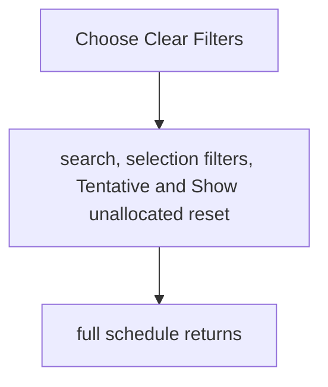
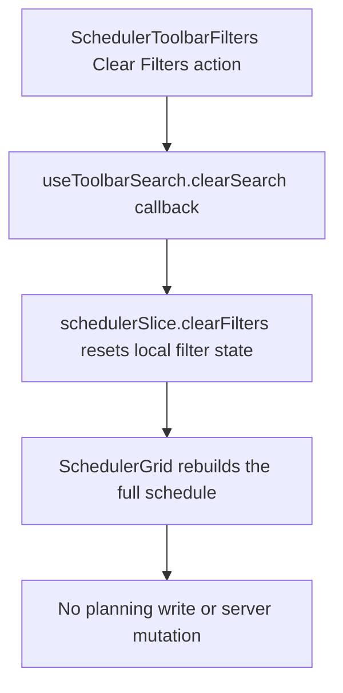

# US-FIL-06 — Clear all filters at once

As a company member, I want to clear all active filters at once so that I can return to the full schedule quickly.

**Status:** Current

**Access:** Viewer, Editor, Admin or Owner

**Entry:** Schedule (`/`)

**Documentation:** [schedule-work.md](../../docs-src/using/schedule-work.md)

**Source:** [SchedulerToolbarSections.tsx](../../apps/frontend/src/components/scheduler/SchedulerToolbarSections.tsx)

## Acceptance criteria

- **Clear Filters** is enabled only when search, a discipline, client, project or activity filter is set, or Tentative is turned off.
- Selecting it resets search, every selection filter, Tentative (back on) and Show unallocated (back off).

## User flow

## Code flow

**Code references:**

- [SchedulerToolbarSections.tsx](../../apps/frontend/src/components/scheduler/SchedulerToolbarSections.tsx)
- [useToolbarSearch.ts](../../apps/frontend/src/components/scheduler/useToolbarSearch.ts)
- [SchedulerToolbar.tsx](../../apps/frontend/src/components/scheduler/SchedulerToolbar.tsx)
- [schedulerModelFilters.ts](../../apps/frontend/src/components/scheduler/schedulerModelFilters.ts)
- [schedulerModel.ts](../../apps/frontend/src/components/scheduler/schedulerModel.ts)
- [SchedulerGrid.tsx](../../apps/frontend/src/components/scheduler/SchedulerGrid.tsx)
- [schedulerSlice.ts](../../apps/frontend/src/store/slices/schedulerSlice.ts)
