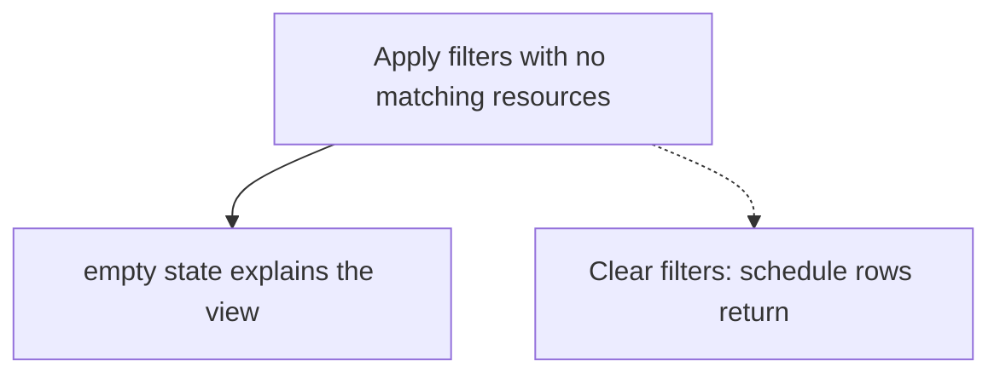
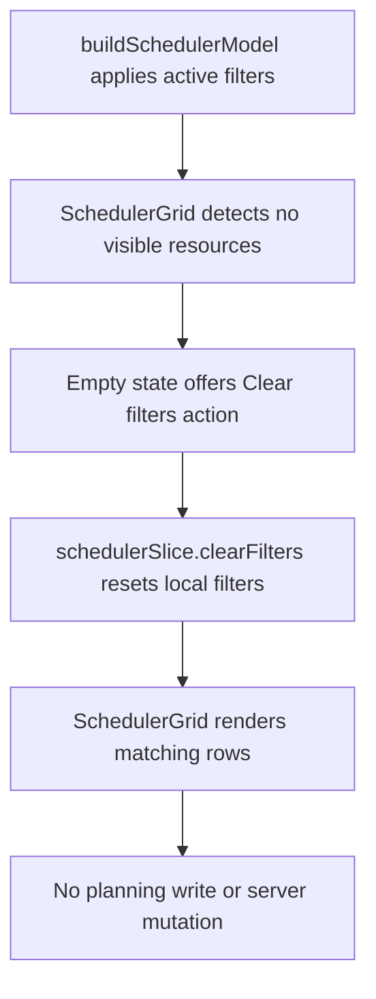

# US-FIL-07 — Empty state when no resource matches

As a company member, I want a clear empty state when filters match no resources so that I know the schedule is filtered rather than missing data.

**Status:** Current

**Access:** Viewer, Editor, Admin or Owner

**Entry:** Schedule (`/`)

**Documentation:** [schedule-work.md](../../docs-src/using/schedule-work.md)

**Source:** [SchedulerToolbarSections.tsx](../../apps/frontend/src/components/scheduler/SchedulerToolbarSections.tsx)

## Acceptance criteria

- When filters leave no resource rows, the Schedule shows **No resources match the current filters.** with a **Clear filters** action.
- Clearing the filters restores the schedule rows.

## User flow

## Code flow

**Code references:**

- [SchedulerToolbarSections.tsx](../../apps/frontend/src/components/scheduler/SchedulerToolbarSections.tsx)
- [SchedulerToolbar.tsx](../../apps/frontend/src/components/scheduler/SchedulerToolbar.tsx)
- [schedulerModelFilters.ts](../../apps/frontend/src/components/scheduler/schedulerModelFilters.ts)
- [schedulerModel.ts](../../apps/frontend/src/components/scheduler/schedulerModel.ts)
- [SchedulerGrid.tsx](../../apps/frontend/src/components/scheduler/SchedulerGrid.tsx)
- [schedulerSlice.ts](../../apps/frontend/src/store/slices/schedulerSlice.ts)
